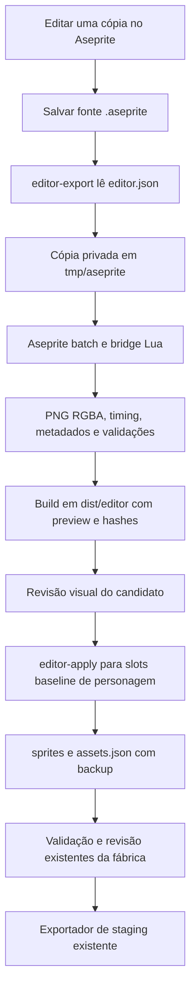

# Integração Aseprite — documentação de ponta a ponta

**Projeto:** TacticsRPG Character Factory  
**Entrega:** 22 de outubro de 2026  
**Estado:** autoria e exportação integradas à fábrica; verificadas com Aseprite 1.3.18.6 da Steam.

Este documento explica o que foi implementado, como os arquivos circulam, como operar a integração e quais resultados foram demonstrados. O [guia de comandos](ASEPRITE.md) oferece uma consulta mais curta. O [relatório consolidado](../reports/aseprite-integration-v1.json) contém os resultados e hashes da implementação entregue.

## 1. O que foi feito

A fábrica passou a usar o executável local do Aseprite para criar fontes vazias organizadas, copiar fontes existentes para revisão e exportar arquivos salvos com contratos explícitos. A edição artística acontece no Aseprite; a fábrica organiza, verifica e registra o resultado.

A integração funciona por **arquivos e linha de comando**. Não foi instalado um botão, extensão ou menu na janela do Aseprite. Não há monitoramento automático de arquivos nem exportação a cada salvamento. O usuário ou agente executa os comandos da fábrica quando deseja produzir um build.

Foram entregues:

| Recurso | Comportamento implementado |
|---|---|
| Configuração e diagnóstico | Localiza o editor, verifica versão e integra o resultado ao doctor. |
| Templates | Cria `.aseprite` vazio com canvas, camadas, quadros e duração definidos. |
| Cópia de trabalho | Preserva uma fonte existente e registra de onde veio a cópia. |
| Exportação | Gera PNGs RGBA8, atlas, durações e metadados a partir da fonte salva. |
| Seleções | Exporta camadas escolhidas, exclui camadas ou seleciona uma tag de animação. |
| Cenários 2D | Exporta tilesets e layout de tilemaps, com índices, posições e flags. |
| Builds | Guarda fontes copiadas, resultados, hashes e proveniência em um pacote verificável. |
| Preview | Mostra clips/tiles com zoom, reprodução, pausa e inspeção por quadro. |
| Aplicação em personagens | Escreve slots baseline conhecidos, com gates, backup e registro de origem. |
| Verificação | Testes automatizados, auditoria do acervo aprovado e conferência de pixels no navegador. |

Os tipos de pacote aceitos são `character`, `enemy`, `environment`, `prop`, `effect`, `ui` e `weapon`. Esses nomes organizam a autoria; não registram automaticamente uma entidade ou comportamento no Unity.

## 2. Arquitetura e fluxo dos dados



Pacotes genéricos, como cenários e efeitos, entregam seus arquivos no build da etapa G. O `editor-apply` é específico dos slots baseline de personagens. A transferência de assets genéricos para estruturas do jogo exige definir seu destino e contrato no projeto Unity.

### Responsabilidades dos componentes

| Arquivo | Responsabilidade |
|---|---|
| [src/cli.mjs](../src/cli.mjs) | Expõe os seis comandos `editor-*` e o diagnóstico no doctor. |
| [src/aseprite.mjs](../src/aseprite.mjs) | Descoberta, validação de manifestos, execução do editor, templates, forks, builds, previews e aplicação. |
| [tools/aseprite/bridge.lua](../tools/aseprite/bridge.lua) | Usa a API do Aseprite para templates e extração de estrutura, tilemaps e tiles. |
| [src/core.mjs](../src/core.mjs) | Reutiliza confinamento de caminhos, hashes, fichas e gates já existentes. |
| [src/images.mjs](../src/images.mjs) | Reutiliza leitura, medição e gravação de PNGs. |
| [test/aseprite.test.mjs](../test/aseprite.test.mjs) | Verifica comportamento do bridge com uma instalação real. |
| [test/fixtures/aseprite.lua](../test/fixtures/aseprite.lua) | Produz somente dados sintéticos para testes; não é arte de produção. |

O Node chama o executável diretamente, sem montar comandos de shell com nomes de assets. O processo usa `--batch --noinapp`, janela oculta, timeout de 120 segundos por chamada e limite de saída de console. O bridge usa apenas Node, pngjs e o Aseprite instalado; nenhuma dependência runtime nova foi adicionada.

### Convivência com a máquina em uso

Os comandos não usam mouse ou teclado, não selecionam janelas e não manipulam o documento aberto na GUI. Cada exportação trabalha sobre uma cópia privada de um arquivo salvo no disco. Alterações ainda não salvas na janela não entram no build. A janela aberta pode continuar sendo usada para autoria enquanto outras tarefas rodam; uma fonte salva durante sua própria exportação pode causar rejeição por mudança de hash, exigindo repetir a exportação.

## 3. Configuração e diagnóstico

O caminho configurado nesta máquina é:

```text
F:\SteamLibrary\steamapps\common\Aseprite\Aseprite.exe
```

Na raiz da fábrica:

```powershell
node src/cli.mjs editor-check
node src/cli.mjs doctor
```

Para configurar outra instalação:

```powershell
node src/cli.mjs editor-config --input 'F:\SteamLibrary\steamapps\common\Aseprite'
```

O comando aceita a pasta ou o executável e grava `config/aseprite.local.json`. Esse arquivo é ignorado pelo Git. O executável e a licença do Aseprite não são distribuídos junto com o repositório.

Nas execuções normais, a precedência é `ASEPRITE_PATH`, configuração local e descoberta automática. A descoberta consulta instalações padrão, registro/bibliotecas Steam e PATH. O caminho explícito fornecido ao configurador é validado diretamente. Uma configuração explícita inválida produz erro; não é silenciosamente substituída por outra instalação.

A versão efetivamente testada foi 1.3.18.6. A verificação aceita a família 1.x a partir de 1.3; outras versões aceitas ainda precisam de verificação real quando forem adotadas. Mudanças de versão também alteram a identificação do build.

`doctor` continua verificando as referências e permite que o editor seja opcional para os comandos antigos. `editor-check` exige um editor utilizável e retorna código 1 quando indisponível. Erros de uso, contratos, gates ou exportação nos demais comandos retornam código 2.

## 4. Estrutura dos arquivos

Uma revisão de personagem usa:

```text
characters/<personagem>/source/aseprite/<revisao>/
  editor.json
  lineage.json                  # em cópias de trabalho
  template.json                 # em templates
  source/
    <fonte>.aseprite
```

Um asset genérico usa a mesma organização em `assets/<kind>/<id>/`. Os campos `kind` e `id` determinam esse endereço para templates/forks genéricos.

Um build exportado usa:

```text
dist/editor/<id>/<build>/
  build.json                    # resultado, proveniência, frames e destinos
  manifest.json                 # contrato usado na exportação
  hashes.json                   # inventário de integridade
  preview.html
  jobs/<job>/
    source.aseprite              # cópia completa da fonte salva
    sheet.png                   # atlas produzido pelo Aseprite
    sheet.json                  # metadados nativos do atlas
    document.json               # estrutura extraída pela API Lua
    frames/000.png ...          # PNGs individuais RGBA8
    tilesets/<tileset-id>/       # quando o job exporta tilesets
      000.png ...
```

`dist/` e `tmp/` são ignorados pelo Git. Para compartilhar um resultado com alguém que só possui um clone, é necessário fornecer ou reconstruir os builds. As fontes e manifestos de autoria devem permanecer versionados no pacote correspondente.

## 5. Fluxo completo para melhorar um asset existente

### 5.1 Escolher uma fonte ativa

O índice de produção Orc está em [reports/aseprite-production-manifest-v1.json](../reports/aseprite-production-manifest-v1.json). Ele foi gerado a partir dos `source-manifest.json` dos builds aprovados, com hashes de fontes selecionadas. Não escolhe automaticamente arquivos históricos ou rejeitados por uma busca genérica de `.aseprite`.

Para reconstruir e auditar esse índice:

```powershell
node tools/audit-aseprite-production.mjs
```

Essa auditoria depende dos builds aprovados apontados pelo relatório Orc e dos seus manifestos de fontes. Em uma máquina sem esses arquivos de `dist/`, restaure/recrie o staging aprovado pelo fluxo existente ou prepare um manifesto explícito para as fontes que deseja trabalhar.

### 5.2 Criar uma cópia de trabalho

Exemplo de uma nova revisão do primeiro Idle front_r do Warrior:

```powershell
node src/cli.mjs editor-fork --manifest reports/aseprite-production-manifest-v1.json --id orc-01 --job orc-01-00 --name orc-idle-fr-v2
```

O comando copia a fonte, registra caminho/hash original em `lineage.json` e cria `editor.json` apontando para a cópia. Retira os campos `compare` e `sourceSha256` da cópia de trabalho, porque a finalidade é permitir mudanças artísticas. Conserva canvas, timing e destinos definidos pelo contrato. Uma revisão já existente não é sobrescrita; use outro nome para outra revisão.

Já existe uma cópia pronta da entrega:

- [Fonte editável](../characters/orc-01/source/aseprite/idle-front-r-editor-v1/source/orc-01-00.aseprite).
- [Manifesto da cópia](../characters/orc-01/source/aseprite/idle-front-r-editor-v1/editor.json).
- [Origem registrada](../characters/orc-01/source/aseprite/idle-front-r-editor-v1/lineage.json).

### 5.3 Editar e salvar

Abra a cópia no Aseprite, faça a revisão e salve o `.aseprite`. Preserve identidade, anatomia, mão dominante, quatro vistas reais e armas independentes conforme a direção artística. Os editáveis atuais possuem cels raster completos; a integração não transforma esses desenhos automaticamente em peças de corpo e roupa.

### 5.4 Exportar e obter o preview

O exemplo abaixo funciona com a cópia já preparada e captura o endereço do build sem precisar digitar seu hash:

```powershell
$editorBuild = node src/cli.mjs editor-export --manifest characters/orc-01/source/aseprite/idle-front-r-editor-v1/editor.json | ConvertFrom-Json
if ($LASTEXITCODE -ne 0) { throw 'Exportação do Aseprite falhou.' }
$editorBuild.path
$editorBuild.preview
```

Abra o `preview.html` informado quando for revisar visualmente. Não é necessário instalar um servidor para apenas exibi-lo. O comando exporta; ele não aplica automaticamente o candidato aos sprites atuais.

### 5.5 Aplicar a um personagem

Após inspecionar o candidato, uma substituição local explícita usa:

```powershell
node src/cli.mjs editor-apply --id orc-01 --build $editorBuild.path --force
node src/cli.mjs preview --id orc-01
node src/cli.mjs validate --id orc-01 --stage full
```

Para um destino novo ou um reexport sem mudanças, `--force` não é necessário. `--force` autoriza substituir PNGs existentes; não ignora gates, não concede aprovação artística e não escreve no jogo.

Se o conteúdo novo for igual ao conteúdo atual em RGBA, o resultado é `UNCHANGED`. Os bytes do arquivo antigo são preservados, mesmo que a nova exportação tenha usado outra compressão PNG. Isso evita invalidar hashes e revisões por uma simples diferença de codificação.

Se houver mudanças, o resultado é `APPLIED_REVIEW_REQUIRED`. A fábrica guarda os PNGs anteriores, registra a origem no histórico de assets e indica o próximo preview.

### 5.6 Revisar e exportar pelo processo existente

Uma mudança em PNGs pode invalidar os gates vinculados ao conteúdo. Alterar somente a cópia `.aseprite` ainda não muda o conjunto de PNGs aprovado; essa mudança passa à produção local quando for aplicada.

Se as vistas/base mudarem, revise novamente a base antes de expandir animações. Mudanças em animações exigem a revisão de consistência correspondente. A aprovação artística é dada pelo criador e registrada pelo comando `review` com evidência real. Depois, o exportador de staging existente entrega o pacote conforme [WORKFLOW.md](WORKFLOW.md).

O exportador complementar dos Orcs continua responsável pelas ações suplementares. Não use o exportador baseline para presumir que suplementos, sockets ou overlays foram incluídos.

## 6. Fluxo para novos personagens, inimigos e assets genéricos

Para outro indivíduo, comece com `new`; para roupa do mesmo indivíduo, use `outfit`. Mantenha conceito e aprovações na ordem já definida pela fábrica. O template do editor organiza um arquivo vazio; não produz um conceito nem um sprite acabado.

Há dois exemplos prontos:

| Exemplo | Uso |
|---|---|
| [aseprite-character-template.example.json](../config/aseprite-character-template.example.json) | Fonte de personagem com quatro quadros, camadas e destinos explícitos. Ajuste personagem/perfil antes de usar. |
| [aseprite-template.example.json](../config/aseprite-template.example.json) | Fonte genérica de cenário/props, com canvas e camadas. |

Para experimentar uma fonte genérica nova:

```powershell
node src/cli.mjs editor-template --manifest config/aseprite-template.example.json
```

Isso cria `assets/environment/forest-props/source/forest-props.aseprite` e seu `editor.json`. Desenhe e salve antes de exportar:

```powershell
node src/cli.mjs editor-export --manifest assets/environment/forest-props/editor.json
```

Templates vazios falham na validação de conteúdo ao exportar, por padrão. Isso diferencia um arquivo de autoria organizado de arte efetivamente produzida.

Inimigos humanoides compatíveis podem seguir o perfil existente. Outras anatomias podem ter fontes e builds com perfis próprios; a compatibilidade com o runtime do jogo continua exigindo demonstração. Fontes de armas ficam em pacotes independentes e não são incorporadas por padrão em Idle/Walk.

## 7. Contrato de exportação: o que cada campo faz

O manifesto possui `schemaVersion:1`, `id`, `kind` e uma lista `jobs`. `characterId` liga o build a uma ficha quando for aplicar sprites. Um job é uma exportação de uma fonte, com seleção e perfil próprios.

| Campo do job | Função |
|---|---|
| `id` | Identificação única dentro do manifesto. |
| `source` | Caminho da fonte `.aseprite`/`.ase`, relativo à fábrica. |
| `sourceSha256` | Opcional: exige uma versão exata da fonte. Útil para auditoria de seleções aprovadas. |
| `profile` | Canvas e verificações técnicas da exportação. |
| `layers` | Opcional: exporta as camadas indicadas por nome/caminho. |
| `excludeLayers` | Opcional: exclui as camadas indicadas. |
| `tag` | Opcional: seleciona um intervalo nomeado da timeline. |
| `compare` | Opcional: PNG esperado para cada quadro, na mesma ordem. Qualquer diferença RGBA bloqueia o build. |
| `targets` | Opcional: slot baseline para cada quadro. É obrigatório para todos os quadros de um build aplicado por editor-apply. |
| `tileset` | Booleano: ativa exportação de biblioteca de tiles. Não é usado com targets/compare/chão de personagem. |

Os campos do perfil são:

| Campo | Significado |
|---|---|
| `width`, `height` | Canvas da fonte; obrigatórios. |
| `frames` | Contagem esperada, quando declarada. |
| `durationMs` | Duração esperada constante. |
| `durationsMs` | Duração esperada por item/quadro; quando fornecida, é a lista usada na comparação. |
| `groundY` | Linha inferior de conteúdo esperada; `null` desabilita essa verificação. |
| `alpha` | `binary` exige alfa 0/255; `any` permite alfa parcial. |
| `requireContent` | Exige conteúdo; true por padrão para sprites, false por padrão para tilesets. |
| `requireTransparency` | Quando true, exige pixels transparentes; fundos e tiles opacos podem deixá-lo desativado. |

Há exemplo JSON completo no [guia operacional](ASEPRITE.md#manifesto-de-exportacao). `targets` usa caminhos relativos a `sprites/` da ficha; `source` e `compare` usam caminhos relativos à raiz da fábrica. Os caminhos são confinados e os slots de personagem são validados.

O exporter não faz redução de conceitos, reescala, espelhamento, rotação, trim ou fusão de quadros duplicados. Preserva quadros vazios e repetidos; frames vazios de sprites precisam ser permitidos explicitamente. Os PNGs individuais finais são RGBA8, inclusive para fontes indexadas.

Sem tag/tileset, a contagem e as durações exportadas também são conferidas contra os headers do arquivo ASE. Exportar metadados de timing não altera os tempos de playback fixados no runtime Unity.

## 8. Como um build é produzido e preservado

1. A fábrica valida o manifesto, os perfis e os caminhos.
2. Calcula os hashes das fontes e verifica qualquer `sourceSha256` declarado.
3. Calcula a identificação do build a partir do manifesto, fontes, versão do Aseprite e hashes do exporter/bridge Lua.
4. Se o build existir, confere seu inventário e o reutiliza. A reutilização é do build completo; não há cache independente por job nesta versão.
5. Para um build novo, cria uma pasta privada em `tmp/aseprite/` e copia cada fonte.
6. Lê o header ASE e executa o Aseprite nessa cópia para produzir atlas e metadados.
7. O Lua extrai a estrutura do documento e, quando solicitado, as bibliotecas de tiles.
8. O Node separa os frames do atlas sem reescala, grava RGBA8 e verifica canvas, timing, alfa, chão, conteúdo e comparações declaradas.
9. Confere se a fonte original permaneceu com o hash esperado durante o job.
10. Grava relatórios, manifesto, preview e inventário de hashes. Publica a pasta completa em `dist/editor/` por renomeação.

Uma falha deixa `failure.json` e resultados parciais na pasta temporária, informada no erro. Esse material é evidência para diagnóstico, não um build aprovado. Um build existente alterado é rejeitado em vez de ser sobrescrito. Restaure os bytes corretos ou produza uma nova revisão identificada; editar hashes para ocultar mudanças elimina a evidência.

Limites técnicos atuais: até 4096 por eixo do canvas, 16 milhões de pixels por PNG/atlas e timeout por chamada. Divida timelines grandes por tags/jobs. Para iterações rápidas, crie uma cópia do clipe que está revisando em vez de reexportar um manifesto de centenas de fontes.

## 9. Aplicação, backup e gates

O apply verifica o build inteiro antes de usá-lo, exige que `characterId` corresponda à ficha e rejeita referências históricas como produção. Também verifica conceito aprovado, base aprovada para animações e vínculo do indivíduo quando o pacote é uma roupa derivada.

Todos os frames precisam ter um `target` conhecido, sem destinos duplicados. Os PNGs precisam ser RGBA8, ter o canvas da ficha, conteúdo, transparência e o chão exigido. A aplicação não aceita arbitrariamente novos estados ou caminhos de suplementos como se fossem slots baseline.

Antes de substituir arquivos diferentes, a fábrica guarda seus bytes em:

```text
characters/<id>/source/aseprite-history/<build>-<sufixo>/
```

O registro em `assets.json` inclui versão do Aseprite, fonte, hash da fonte, build, hash do PNG, duração e endereço de backup. `applied.json` documenta o lote aplicado.

O tratamento de exceções durante a escrita dos PNGs e de assets.json tenta restaurar o estado anterior. Isso é rollback de software, não uma transação do sistema de arquivos contra queda de energia ou encerramento abrupto. Não há comando `editor-rollback` nem bloqueio entre dois applies simultâneos; opere uma aplicação por personagem de cada vez. Os backups permitem recuperar os PNGs anteriores pelo fluxo de importação existente, com validação e revisão de hashes.

Validação técnica e aplicação nunca registram aprovação artística. Gate 3 continua dependendo de evidência real no jogo.

## 10. Cenários: tilesets, tilemaps e coordenadas

Uma fonte de cenário pode ser exportada por um job normal, para seu render, e por um segundo job com `tileset:true`, para a biblioteca de tiles. A fonte precisa conter uma layer tilemap real; raster comum não é apresentado como tilemap.

Nos jobs de tileset, `profile.width/height` descreve o canvas do documento. Os PNGs exportados têm as dimensões nativas dos tiles, e o índice vazio também é preservado. O atlas segue as seleções/visibilidade da exportação; o inventário extraído por Lua descreve as bibliotecas completas do documento, incluindo tilesets não utilizados por uma layer visível.

Cada biblioteca recebe `tilesetId` próprio, mesmo que duas tenham o mesmo nome. No build, cada combinação tilesetId/índice aponta explicitamente para um PNG RGBA8 e seu hash. Assim, o consumidor não precisa adivinhar a biblioteca pelo nome ou pela ordem dos itens do atlas.

O layout em `document.json` preserva:

- Layer e tilesetId associados ao cel.
- Frame, posição do cel em pixels e dimensões da grade.
- Largura/altura nativa do tile e baseIndex do Aseprite.
- Células `{x,y,tile,flags}`, incluindo flags de flip como dados.

As coordenadas x/y de célula são relativas à grade do cel; a posição do cel é o deslocamento em pixels no documento. O arquivo preserva o índice interno do tile e o baseIndex separadamente; não executa uma conversão para IDs de tiles do Unity. No JSON extraído, `frames[].number` usa a numeração 1-based do Aseprite; `tilemaps[].frame` e os intervalos de tags usam índices 0-based.

Para tiles indexados, os PNGs individuais usam a paleta do primeiro frame, registrada como `paletteFrame:0`. Outras paletas permanecem na fonte completa. Um consumidor que precise de paleta animada deve definir e verificar esse contrato antes de usar a biblioteca como se fosse uma única aparência fixa.

Essa entrega permite preparar arte e dados 2D de cenário. Alturas, colisões, materiais, iluminação, oclusão e colocação no mapa 3D do TacticsRPG pertencem a uma integração específica do jogo.

## 11. O que foi verificado

Os resultados registrados na entrega são:

| Verificação | Resultado e evidência |
|---|---|
| Suite local | 13 testes passaram, zero falhas e zero skips na máquina da entrega. [Relatório consolidado](../reports/aseprite-integration-v1.json). |
| Fontes de produção | 216 fontes selecionadas dos oito pacotes Orc. [Auditoria](../reports/aseprite-production-audit-v1.json). |
| Pixels e timing | 888 quadros exportados idênticos em RGBA e com durações preservadas. |
| Fallbacks | Oito fallbacks equivalentes às vistas front_r; cobertura total de 896 PNGs. |
| Preservação | 1112 arquivos originais e oito arquivos de reviews conferidos sem alteração. |
| Cenário sintético | Tiles, índices, posições, flags e bibliotecas com nomes repetidos. [Capabilities](../reports/aseprite-capabilities-v1.json). |
| CLI real no Orc | Fork/export/apply de quatro quadros, com resultado UNCHANGED e PNGs/assets/reviews preservados. [Fluxo](../reports/aseprite-character-flow-v1.json). |
| Navegador | 888 quadros de produção + seis itens sintéticos com RGBA exato; controles e exibição por arquivo local passaram, sem erros JavaScript. [Verificação de preview](../reports/aseprite-preview-validation-v1.json). |

A última etapa de exportação/comparação do lote registrou **47.926 ms**, cerca de 48 segundos. Esse é um resultado desta máquina e deste lote, não uma garantia para outros tamanhos/ambientes. A conferência exata de canvas no navegador foi feita por HTTP local; a exibição file:// foi verificada separadamente.

O teste de cenário é identificado como sintético e não equivale a arte final aprovada. Os testes verificam templates/forks, layers/tags, exclusões inexistentes, frames vazios/repetidos, timing, caminhos, integridade, gates, backup e idempotência. Em outra máquina sem Aseprite, o teste que depende do editor real pode informar SKIP.

Para repetir as verificações quando houver mudanças relevantes:

```powershell
npm.cmd test
node tools/audit-aseprite-production.mjs
node tools/verify-aseprite-capabilities.mjs
node tools/verify-aseprite-character-flow.mjs
& 'tmp/pixel-venv/Scripts/python.exe' tools/check-aseprite-preview.py
```

O Python/Playwright/Edge da última linha é o ambiente de verificação já existente nesta máquina, não uma dependência runtime do bridge. `verify-aseprite-character-flow` conserva uma cópia real de trabalho; se ela tiver sido editada depois da entrega, o resultado UNCHANGED deixa de ser esperado e o script não força sua aplicação.

## 12. Diagnóstico de problemas

| Sintoma | Interpretação e ação |
|---|---|
| Editor indisponível | Rode editor-check; confira ASEPRITE_PATH e editor-config. |
| Versão rejeitada | O editor não corresponde à família aceita; verifique antes de mudar a política de versão. |
| Fonte alterada | Um hash fixado não corresponde ou o arquivo foi salvo durante a exportação. Identifique a revisão correta; para trabalho novo, use fork. |
| Frame vazio | Ainda há um template sem desenho ou um vazio não permitido. Corrija a arte ou declare requireContent false quando o vazio for intencional. |
| Layer/tag inexistente | Corrija o nome/caminho no manifesto; a exclusão não é silenciosamente ignorada. |
| Contagem/timing divergente | O arquivo salvo e o perfil não correspondem. Revise a timeline e o contrato. |
| RGBA diferente de compare | A auditoria encontrou mudança de pixels; compare é adequado a preservação, não a um candidato que deve ser artisticamente diferente. |
| Destino existente | Há pixels diferentes. Inspecione o preview antes de executar apply com --force. |
| Gate concept/base inválido | Retome a revisão artística exigida; --force não contorna o gate. |
| Build alterado/incompleto | Restaure o bundle correto ou crie outra revisão. Consulte hashes.json e a evidência da exportação. |
| Falha após processamento parcial | Consulte a pasta tmp/aseprite indicada e seu failure.json. Nenhum build PASS foi publicado. |

## 13. Economia, escala e limites da entrega

Os comandos de exportação são locais e não usam tokens de modelo nem uma API de geração. O resumo no console evita precisar carregar todos os metadados na conversa; os detalhes ficam nos relatórios. Builds integralmente idênticos podem ser reutilizados. Uma alteração em um job de um manifesto grande gera outro build e reprocessa seu lote, pois o cache atual é por build completo.

A economia de geração depende de quanto trabalho artístico puder ser corrigido ou reutilizado no editor. Não foi medida uma porcentagem de economia de tokens. O bridge não desenha anatomias, não separa roupas de um PNG chapado e não garante consistência artística entre vistas. Templates com camadas permitem organizar peças futuras quando essas peças forem efetivamente autoradas e registradas.

O suporte de autoria/exportação está concluído neste escopo. Permanecem como trabalho do projeto do jogo: registro de personagens, importadores específicos de assets genéricos, conversão de mapas 2D para terreno 3D, armas dinâmicas, sockets, oclusão e sincronização de ações. A fábrica continua fornecendo staging; nenhum desses comportamentos foi declarado implementado apenas por exportar PNGs ou JSON.

As decisões de continuidade estão em [ROADMAP.md](ROADMAP.md); os contratos de equipamento permanecem em [EQUIPMENT_AND_ACTIONS.md](EQUIPMENT_AND_ACTIONS.md).

## 14. Fontes e consulta rápida

- [Guia operacional e exemplos JSON](ASEPRITE.md).
- [Relatório completo da integração](../reports/aseprite-integration-v1.json).
- [Preview do acervo auditado](../dist/editor/orc-production-aseprite-v1/dcbb8fa6c7a9e7abf846/preview.html).
- [Preview técnico sintético de cenário](../dist/editor/aseprite-capabilities-v1/79f3c0ba22e9ee51e47b/preview.html).
- [CLI oficial do Aseprite](https://www.aseprite.org/docs/cli/).
- [API Lua oficial](https://www.aseprite.org/api/).
- [Tilemaps no Aseprite](https://www.aseprite.org/docs/tilemap/).

Os links de dist apontam para artefatos reais desta entrega, guardados localmente. Em outra máquina, precisam acompanhar o pacote ou ser reconstruídos. Documentação descreve o código entregue e as evidências registradas; aprovações artísticas continuam sendo as decisões reais do criador vinculadas aos arquivos.
