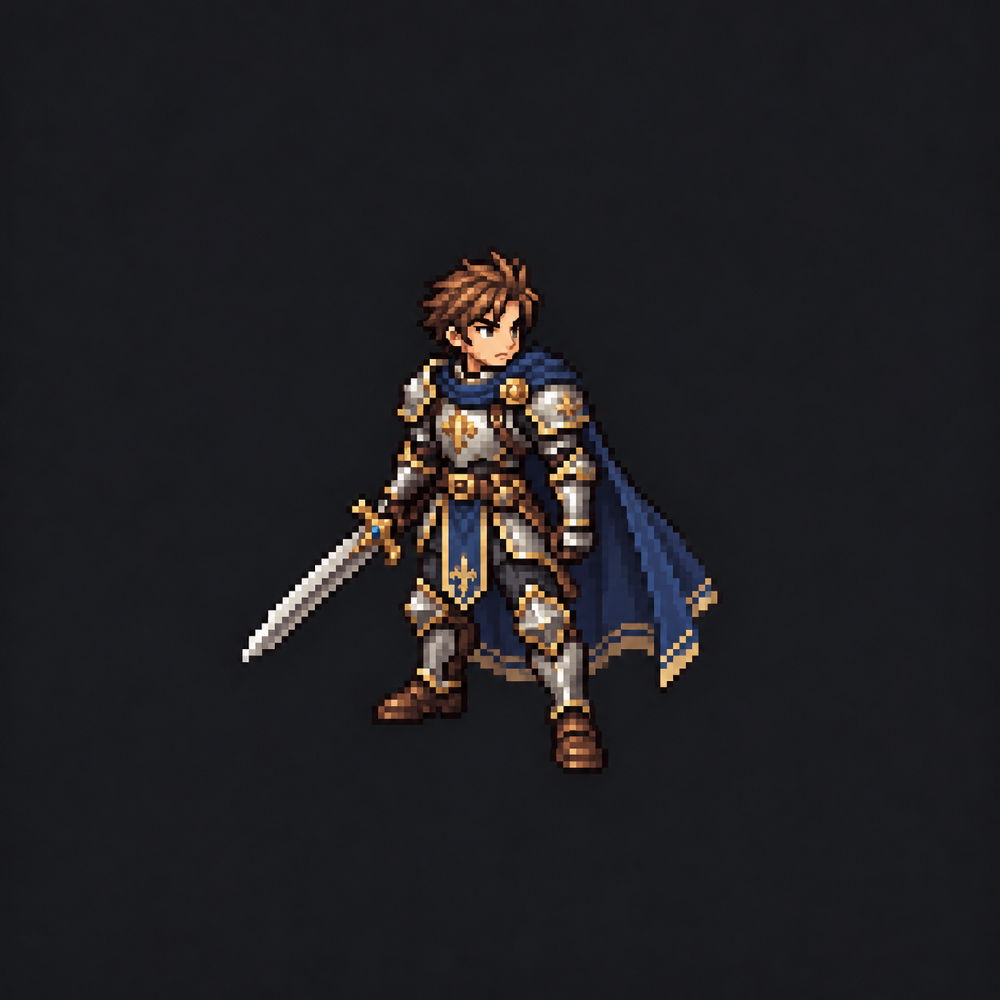
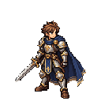

## Política vigente — Orc principal e armas somente no ataque, 2026-10-25

O Orc principal atual é **orc-v1 / Verde Warcraft**, em characters/orc-v1/. O antigo Orc V4 está descartado e nunca é fonte de restauração ou direção atual. A identidade atual é a referência; poses de ataque defeituosas podem ser substituídas.

Espada/machado ficam **ocultos no Idle, Walk, repouso, inspeção, Hit/Defeat e após a ação**. Aparecem somente no intervalo declarado do Attack. Os pedidos anteriores de Idle/Walk armados e o corte único compartilhado entre Sword/Axe estão **SUPERADOS**. São dois perfis: corte de espada e golpe de machado, reutilizáveis entre itens compatíveis da própria categoria. Sem sacar/embainhar, rig universal ou animação corporal por item.

Guia atual: docs/MAIN_ORC_ONE_HANDED_RESCUE.md; autoridade de identidade: reports/orc-production-current.json. Armas seguem a linguagem visual do jogo, sem obrigação de copiar a paleta/cultura Orc. Aseprite continua mestre; PixelLab autorizado auxilia poses; toda edição/exportação artística é no Aseprite. Esta tarefa não modifica Unity nem concede aprovação artística. **Nos registros anteriores abaixo, toda afirmação conflitante de V4 ativa, nenhuma seleção, arma em Idle/Walk ou movimento universal é histórica e superada.**

## Decisão vigente — Orc V1 e armas, 2026-10-25

Esclarecimento vigente: armas pertencem à linguagem visual do jogo e serão reutilizadas entre raças/classes. Não precisam copiar design, paleta ou cultura Orc. Coerência vem de pixel, contorno, materiais, luz, contraste, escala e acabamento, não de uniformizar todos os itens. Lote armado v1 rejeitado; revisão candidata com Idle/Walk/golpe e movimento compartilhado em `docs/ORC_V1_WEAPONS_V2.md`. Infante original permanece em `Orcs Atuais/05 - Infante de Ferro/`; a menção histórica a Arquivo abaixo foi superada.

Criador selecionou Verde Warcraft v3 como **Orc V1**, primeiro jogável para futura integração. Fonte em `characters/orc-v1/`; Infante cinza preservado na biblioteca em Orcs Atuais/05 - Infante de Ferro/. Novos assets de uma mão: Espada do Recruta e Machado de Milícia, seguindo `docs/WEAPON_ART_STANDARD.md`. Golpe composto e Walk completo equipado em uma vista, com mestres/camadas/encaixes; a autorização anterior de Walk armado está SUPERADA: attack-only-v1 agora exige Idle/Walk sem armas. Corpo base e Idle fixo permanecem independentes. Página `Biblioteca de Arte/Personagens Jogaveis/Orc V1/index.html`; documentação `docs/ORC_V1_WEAPONS.md`. São assets/prévias locais, não integração Unity ou aprovação automática dos novos golpes/armas. V4 continua descartada; não confundir seleção para integração futura com produção completa em quatro vistas.

## Padrão fixo obrigatório de Idle — 2026-10-25

PADRÃO FIXO OBRIGATÓRIO para criação de personagens e variantes: Idle normal segue o meio-termo aprovado, ID `idle-balanced-v1`, cinco fases com 400/450/500/450/400 ms (2200 ms), intensidade equivalente a 2 px na cabeça de humanoide 128×128. Não criar um padrão por personagem, Job, roupa ou personalidade. Ajustes de encaixe anatômico/escala preservam o mesmo ritmo e sutileza; divergências exigem autorização explícita do criador. Canon: `docs/IDLE_ART_STANDARD.md` e `config/idle-art-standard-v1.json`; biblioteca `PADRAO-DE-IDLE.md`. Baselines e notas históricas permissivas abaixo não prevalecem. Artes existentes não são migradas automaticamente e não há integração Unity neste pedido.

# Identidade visual

**Histórico superado — 2026-10-24:** V4 ativa e V4 Reimaginado descartados pelo criador; não reutilizar como direção selecionada nem reativar pelos scripts históricos. Arquivos preservados como histórico. Nenhuma seleção de produção ativa. Novo candidato `orc-pixellab-11` (Orc Atlético): parecido com o Ágil, menos armadura, mais musculatura e verde um pouco mais claro. Revisão corrente: `reports/orc-current-review/review.html`. Vigia e Matriarca ficam separados em `ideas/unique-characters-or-npcs/` como ideias futuras de NPC e/ou jogáveis únicos. Esta decisão substitui afirmações históricas de V4 selecionada abaixo.

**Experimento mais recente — PixelLab + Aseprite:** produzir três conceitos Orc novos com inspiração Tolkien/World of Warcraft e estudos de animações básicas, sem consultar ou usar a V4, sua concept art ou referências legadas como condicionamento. [Decisão e protocolo](PIXELLAB_ASEPRITE.md). O objetivo é avaliar uma direção independente; coerência com a âncora antiga não é requisito desse experimento. Uma nova âncora depende da escolha explícita do criador.

Direção Orc reafirmada pelo criador em 2026-10-23: Orc clássico medieval, **principalmente World of Warcraft e também Tolkien**. O agente assume propostas de luz, textura e paleta; apresentar cinco opções concretas para escolha e refinamento usando o Warrior como laboratório. Objetivo: identidade própria e um jogo com alma, fugindo do aspecto genérico de IA. [Decisão e critérios completos](ORC_ART_LAB.md). As alternativas ainda não substituem a âncora nem a produção V4.

O alvo e personagem 2D em pixel art refinada, legivel em batalha tatica. A apresentacao pode combinar sprites com o mapa 3D do Unity (2.5D e inspiracao HD-2D). HD-2D descreve uma apresentacao visual; nao transforma personagem em modelo 3D. Esta fabrica trabalha com PNGs e fontes artisticas 2D.

## Autoridade

Consulte [ART_DIRECTION.md](../references/tacticsrpg/Docs/ART_DIRECTION.md) e a [ancora aprovada](../references/tacticsrpg/Docs/Art/References/character_style_anchor_v1.png). A ancora define proporcao, materiais, qualidade de sombreamento, maturidade facial, densidade de detalhe e leitura. O usuario aprova cada nova referencia racial/de Job; configs locais derivadas permanecem propostas quando acrescentam conteudo ausente nas fontes.

## Hero como ponto de partida

O Human Warrior Pilot ocupa o Hero no sandbox; nao e o protagonista definitivo. Foi usado para validar escala, direcoes, billboard, Idle/Walk e clipes. E um humano com armadura prata, ornamentos dourados contidos, capa azul e espada embutida. Esses detalhes pertencem ao piloto. Uma Orc arqueira pode ter anatomia, paleta e roupa proprias e continuar na mesma linguagem visual.

O Hero possui revisoes parciais em datas diferentes. [HUMAN_WARRIOR_PILOT.md](../references/tacticsrpg/Docs/Art/Characters/HUMAN_WARRIOR_PILOT.md) e mais detalhado que o resumo geral do pipeline. Caminhada/combate e handedness ainda possuem pendencias historicas; nao promover os 97 PNGs a arte final aprovada. A ficha hero-reference nesta fabrica fica reference_only e nao e exportavel como producao.

## Personagem base e armas separadas

Conceitos e sprites do personagem representam o corpo e a roupa sem arma empunhada, carregada ou embainhada. Armas sao assets independentes e so aparecem quando estao equipadas e uma acao/animacao as invoca; nao entram por padrao em Idle, Walk ou na arte base. Corpo, roupa, postura e silhueta do Job devem continuar reconheciveis sem a arma. O Human Warrior Pilot, com espada desenhada nos sprites, e uma excecao historica do prototipo.

O contrato visual esta definido; o runtime ainda nao tem o overlay/equipamento dinamico necessario. A fabrica nao deve apresentar uma composicao offline como se ela demonstrasse esse comportamento em jogo.

## Inspiracoes aplicadas

| Inspiracao | O que orientar | Limite |
|---|---|---|
| Final Fantasy Tactics | Leitura de unidade, identidade de Job, proporcoes taticas compactas, quatro vistas | Designs originais do projeto |
| World of Warcraft | Materiais, armaduras marcantes, arquetipo reconhecivel | Detalhe controlado e proporcoes sem exagero cartunesco |
| Tolkien | Fantasia medieval seria, maturidade, culturas e atmosfera heroica | Nenhum design protegido reproduzido |
| Triangle Strategy / HD-2D | Pixel art com profundidade e efeitos de cenario | Acabamento de cena nao substitui pixel art do personagem |

As tres primeiras bases constam em ART_DIRECTION; Triangle Strategy tambem consta nas decisoes de design. Links oficiais para consulta futura: [FFT](https://final-fantasy-tactics-the-ivalice-chronicles.square-enix-games.com/en-us), [Triangle Strategy/HD-2D](https://www.square-enix-games.com/it_IT/news/triangle-strategy-meta-quest-launch-interview). A pipeline nao baixa sprites comerciais nem depende desses sites para funcionar.

## Constancia por meses

Conservar a mesma versao da ancora e receitas aprovadas. Cada ficha recebe styleId; cada importacao registra hash, fornecedor/modelo quando conhecidos e prompt relacionado. Evoluir uma ancora exige nova versao e decisao do criador. Geracao estocastica nao promete imagem identica com o mesmo texto.

Uma receita visual de Archer aprovada deve descrever silhueta, materiais, proporcao do arco/aljava e limites de variacao. Ela ainda nao existe no catalogo: os 63 Jobs possuem papel mecanico e afinidades, nao 63 uniformes prontos. Desenvolver o primeiro Archer e uma decisao visual candidata. Reutiliza-se a linguagem de classe em outras racas, com adaptacoes anatomicas e culturais justificadas.

## Campos para aprovar antes de escalar

Rosto e corpo individual; anatomia racial; idade visual; mao dominante; assimetrias; silhueta do Job; materiais/paleta; direcao de luz observada; equipamento; perfil de canvas/escala. Acordo tecnico e qualidade artistica sao revisoes diferentes.
