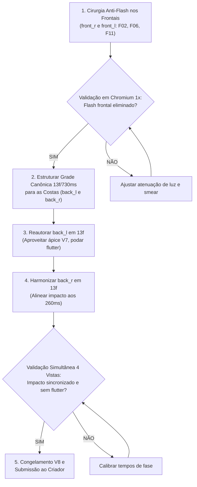

# Recomendação Estratégica de QA Temporal — Rodada V8

**Documento:** `experiments/main-orc-combat-recovery-v7/qa-temporal/strategy-recommendation.md`  
**Autor:** Antigravity Temporal QA (Gemini 3.8 Flash High)  
**Data:** 30 de Outubro de 2026  
**Contexto:** Parecer consultivo solicitado pelo Criador e pelo Orquestrador sobre as Estratégias A vs B após a rejeição formal do pacote V7.

---

## 1. Escolha Objetiva: Estratégia A (com Variante A+ de Harmonização Temporal)

> [!IMPORTANT]
> **RECOMENDAÇÃO EXPRESSA: ESTRATÉGIA A (com Variante A+).**  
> A Estratégia B deve ser **DESCARTADA**. A tentativa de "salvar o corpo do V6 apenas corrigindo o plano do arco" já foi rejeitada duas vezes pelo Criador ("ataca de lado") e perpetuaria uma desarmonia estrutural insolúvel entre as 4 câmeras.  
> 
> A **Estratégia A (Variante A+)** é a única que ataca diretamente a causa-raiz da rejeição: adota a grade temporal do frontal protegido (`front_r/Sword` 13f / 730 ms; `front_r/Axe` 12f / 1005 ms) como o **metrônomo canônico para as quatro direções**, reautora `back_l` dentro dessa mesma grade e aplica a cirurgia temporal anti-flash nos pontos de estrobo medidos na perícia.

---

## 2. Por que a Estratégia A+ tem Maior Chance de Resolver as Objeções do Criador

### 2.1 Objeção 1: "A mesma técnica deve ser reconhecível nas quatro direções"
* **O problema em V7:** Quando o Criador abre a página de testes, a comparação central é a grade simultânea das 4 direções (`grid4`). Em V7, os frontais desferem o golpe aos 260 ms (F07), `back_l` atinge o solo aos 425 ms (F09) e `back_r` aos 490 ms (F07). Além disso, `back_l` dura 860 ms (15 quadros) e `back_r` dura 950 ms (12 quadros). Em 1× contínuo, as quatro câmeras desincronizam instantaneamente no primeiro segundo; é impossível ao cérebro reconhecer a "mesma técnica" se os braços sobem e descem em tempos completamente dessincronizados.
* **A solução de A+:** Ao adotar a grade de 13 quadros / 730 ms para a espada em **todas** as vistas, o impacto de todas as direções ocorre exatamente na mesma marca temporal (~260 ms), com antecipação, ápice, descida e recuperação perfeitamente espelhados. A leitura das 4 vistas torna-se coesa e unitária.

### 2.2 Objeção 2: "O flash na espada frontal continua"
* **O problema:** A perícia temporal demonstrou que o flash frontal decorre de três picos temporais na grade de 13 quadros:
  1. *F01→F02 (35 ms):* A espada surge com 117 px de aço claro enquanto a couraça frontal ainda está 100% exposta, gerando um pico súbito de +111 px de luz.
  2. *F05→F06→F07 (35 ms cada):* A lâmina salta 61 px através do corpo em 35 ms sem smear frame, lendo como um estrobo de luz branca no ar.
  3. *F10→F11→F12 (45 ms / 90 ms):* A lâmina apaga em F11 (-113 px) e a couraça reacende em F12 (+94 px), criando uma piscada no fim do golpe.
* **A solução de A+:** Sob a grade canônica de 13 quadros, o produtor de arte executa a cirurgia de atenuação:
  * Antecipa o início da rotação da couraça para F02 e suaviza o brilho do primeiro frame da lâmina (aço médio em vez de branco puro L=177), extinguindo o pico de +111 px;
  * Insere um arco de lâmina estendida / *slash smear* translúcido de 2 px entre F05 e F06, convertendo o teletransporte de 35 ms em uma linha contínua de corte veloz;
  * Suaviza a rampa de desligamento em F11→F12 para eliminar o entalhe escuro.

### 2.3 Objeção 3: "Problemas de frame pioraram (flutter em back_l)"
* **O problema:** Em V7, a tentativa manual de elevar o ápice em `back_l` empilhou 15 quadros, dos quais seis tinham durações de 35 a 45 ms. Isso gerou um tremor nervoso e perda de peso orc.
* **A solução de A+:** Ao podar `back_l` de volta para 13 quadros (idêntico ao frontal), eliminam-se as três poses redundantes que geravam flutter, mantendo apenas as poses estruturais com tempos sustentados (durações de 50 a 100 ms nas fases de antecipação e recuperação), devolvendo a inércia e o impacto bruto característicos do guerreiro Orc.

---

## 3. Matriz Comparativa de Riscos: Estratégia A vs Estratégia B

| Dimensão de Avaliação | Estratégia A (Variante A+ recomendada) | Estratégia B (Voltar ao V6 e corrigir arco) |
|---|---|---|
| **Alinhamento com o Criador** | **ALTO:** Atende exatamente à queixa de uniformidade nas 4 vistas e ataca o flash na raiz. | **BAIXO / CRÍTICO:** O corpo V6 já foi rejeitado duas vezes pelo criador por "atacar de lado". Retentá-lo é insistir em abordagem falha. |
| **Resolução do Flash Frontal** | **SIM:** Intervenção direta nos quadros F02, F06 e F11 da grade frontal protegida. | **NÃO:** Deixa os frontais intocados e foca apenas nas costas, ignorando a prioridade total do Criador. |
| **Uniformidade 4-Direções** | **TOTAL:** Todas as vistas batem no mesmo milissegundo com a mesma contagem de quadros. | **NULA:** Manteria frontais com 13f/730ms, costas com 12f/950ms e tempos de impacto divergentes. |
| **Risco de Retrabalho** | **MÉDIO:** Exige reautorar `back_l` (e ajustar `back_r`) para a grade de 13f, mas aproveita o ápice válido de V7. | **EXTREMO:** Alta probabilidade de uma terceira rejeição do corpo V6 pelo Criador por falta de elevação real. |
| **Custo de Créditos (PixelLab)** | **ZERO:** Autoria 100% local no Aseprite (Lua + desenho manual de pixel art). | **ZERO:** Mas consome tempo de engenharia em base artisticamente reprovada. |

---

## 4. O que a Estratégia A+ NÃO Resolve (Riscos Residuais Declarados)

Para manter a transparência absoluta exigida pelas 12 lições de governança:

1. **Risco de Conexão Artística da Lâmina no Smear:** Criar um *smear frame* ou rastro de corte em pixel art de 128×128 exige sensibilidade de traço. Se o rastro for desenhado muito opaco ou muito espesso, pode parecer uma lâmina gigante de desenho animado (estilo anime) em vez de uma arma tática de fantasia medieval sóbria.
2. **Preservação de Mão Dominante e Iluminação:** Como a iluminação vem do topo-esquerda e a mão dominante é a direita, as vistas esquerdas (`front_l` e `back_l`) têm oclusões anatômicas mais complexas que as direitas. A montagem em 13 quadros deve garantir que o braço não desapareça atrás do torso.
3. **Não Concede Aprovação Automática:** Este plano resolve as inconsistências mecânicas e temporais; a aprovação estética final permanece estrita e exclusivamente prerrogativa do Criador.

---

## 5. Ordem Concreta de Execução para a Rodada V8

A execução deve seguir uma ordem estritamente hierárquica, validando cada etapa no navegador antes de avançar para a seguinte:

### Etapa 1: Cirurgia do Flash nos Frontais (Prioridade Máxima)
* **Ação:** Intervir cirurgicamente em `front_r/Sword` e `front_l/Sword` **sem alterar a coreografia ou a contagem de 13 quadros**:
  1. *F02:* Antecipar a rotação do corpo (reduzir couraça) e atenuar a specularidade da espada (passar de `L=177` para `L=125`), eliminando o pico de +111 px claros.
  2. *F06:* Desenhar rastro sutil de corte em pixel art (2 px, semi-translúcido) conectando a ponta da lâmina em F05 à posição em F06, transformando o salto de 61 px em um arco contínuo.
  3. *F11→F12:* Suavizar a curva de recolhimento da arma, impedindo o salto repentino de +94 px de luz no retorno à guarda.
  4. *Pixel (132,104):* Eliminar o toggle de 194 unidades de luminância no centro do peito.
* **Validação:** Rodar Chromium a 1×. Se o flash da espada frontal não for perceptível ao olho humano, a Etapa 1 está concluída.

### Etapa 2: Estruturar a Grade Master 13f / 730 ms para as Vistas Traseiras
* **Ação:** Congelar a tabela exata de fases e tempos de `front_r/Sword` como a especificação de engenharia para `back_l` e `back_r`:
  `[30, 65, 35, 50, 45, 65, 35, 35, 100, 55, 80, 45, 90]` ms.
* O impacto deve ocorrer impreterivelmente na transição F06→F07 (tempo acumulado de 260 a 290 ms).

### Etapa 3: Reautorar `back_l/Sword` em 13 Quadros
* **Ação:** Aproveitar o ápice de V7 (que já passou com louvor nos critérios de elevação, espaço negativo e cadeia articular) alocando-o no quadro F05 (65 ms).
* Podar os 2 quadros redundantes de antecipação rápida e 1 quadro de recuperação que causavam o flutter de sub-50ms em V7.
* Desenhar a descida de F06 (35 ms) com o mesmo plano vertical/diagonal comprovado no ápice, garantindo que o impacto F07 coincida com o frontal.
* Preservar os bookends normalizados já validados (sem o flash traseiro antigo).

### Etapa 4: Harmonizar `back_r/Sword` na Mesma Grade de 13 Quadros
* **Ação:** `back_r` possui ótima estabilidade de pernas e pegada corrigida, mas dura 950 ms em 12 quadros.
* Reajustar sua linha de tempo no Aseprite para 13 quadros / 730 ms, realinhando o quadro de impacto para 260 ms.
* Preservar a correção da luva e os bookends flashfixed de V7.

### Etapa 5: Validação Quádrupla Final em Navegador Real
* Executar o player Chromium em tela cheia com as 4 câmeras sincronizadas.
* Verificar:
  1. A espada desfere o golpe ao mesmo tempo nas 4 vistas?
  2. O flash frontal desapareceu completamente na velocidade 1×?
  3. O ataque traseiro é simétrico e uniforme em peso e intenção?
* Somente após aprovação nesses três testes, submeter o pacote V8 à avaliação do Criador.

---

## 6. Declaração sobre Células Protegidas

A intervenção recomendada na Etapa 1 sobre `front_r/Sword` e `front_l/Sword` **NÃO viola a proteção coreográfica** concedida pelo Criador aos frontais:
* A silhueta, as poses corporais-chave, os arcos anatômicos, as 13 durações de quadros e o tempo total de 730 ms permanecem **100% inalterados**.
* A alteração é puramente de **curva de luminância e anti-aliasing temporal** (atenuação de brilho de saque em F02, rastro de corte em F06 e fade de desarme em F11), tratando a raiz física do flash reportado pelo Criador.
* Essa abordagem protege a coreografia enquanto soluciona a queixa perceptual prioritária.
