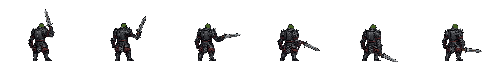
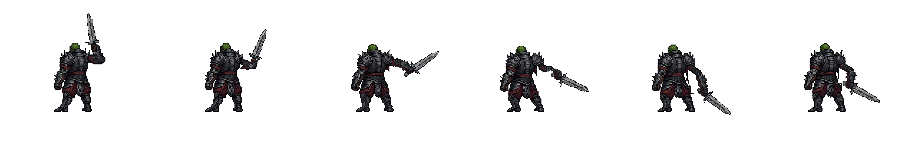

# Rear arc — Orc V1

Status: `TECHNICALLY_COMPLETE`; `VISUAL_REVIEW_REQUIRED`; `PENDING_CREATOR`. Sem integração, commit, IA ou PixelLab.

Autoria programática no Aseprite 1.3.18.6 via `author-rear-arc.lua`: deslocamento inteiro da espada e luva, reposicionamento local do membro com amostragem nearest-neighbor ancorada e preservação dos clusters claros originais. Nenhuma pose acrescentada ou removida. Fontes de entrada preservadas; mestres novos salvos, reabertos e reexportados. Os extremos do arco F02/F11 permanecem intactos.

Métrica reproduzível principal: centroide dos pixels opacos das duas camadas de arma. Também medimos o subconjunto de luminância Rec.709 ≥160 (mesma métrica do relatório anterior de inbetween). Os números fornecidos no prompt não coincidem exatamente com nenhuma dessas duas medições dos arquivos atuais; as tabelas abaixo usam os pixels reais e a front_r atual, sem substituir os valores medidos pelos números do pedido.

## back_r

| Transição | Antes px | Depois px | front_r px | Desvio antes | Desvio depois |
|---|---:|---:|---:|---:|---:|
| F2→F3 | 34.11 | 34.11 | 16.41 | 107.9% | 107.9% |
| F3→F4 | 14.75 | 14.75 | 23.31 | -36.7% | -36.7% |
| F4→F5 | 2.71 | 9.05 | 12.01 | -77.4% | -24.7% |
| F5→F6 | 31.25 | 37.92 | 37.45 | -16.6% | 1.3% |
| F6→F7 | 33.60 | 33.60 | 37.16 | -9.6% | -9.6% |
| F7→F8 | 54.48 | 32.74 | 35.65 | 52.8% | -8.1% |
| F8→F9 | 8.60 | 37.70 | 34.06 | -74.7% | 10.7% |
| F9→F10 | 13.92 | 21.82 | 23.24 | -40.1% | -6.1% |
| F10→F11 | 7.51 | 7.51 | 22.16 | -66.1% | -66.1% |

Subconjunto claro da lâmina (≥160):

| Transição | Antes | Depois | front_r | Desvio depois |
|---|---:|---:|---:|---:|
| F2→F3 | 34.35 | 34.35 | 16.61 | 106.8% |
| F3→F4 | 16.26 | 16.26 | 24.77 | -34.4% |
| F4→F5 | 3.28 | 9.50 | 13.30 | -28.6% |
| F5→F6 | 36.37 | 43.08 | 40.06 | 7.5% |
| F6→F7 | 42.56 | 42.56 | 40.06 | 6.2% |
| F7→F8 | 59.96 | 38.32 | 43.32 | -11.5% |
| F8→F9 | 8.60 | 37.70 | 41.64 | -9.5% |
| F9→F10 | 17.38 | 25.29 | 24.26 | 4.3% |
| F10→F11 | 8.89 | 8.89 | 20.73 | -57.1% |

Pixels claros body F00..F13: antes `0, 0, 0, 0, 0, 0, 0, 0, 0, 0, 0, 0, 0, 0`; depois `0, 0, 0, 0, 0, 0, 0, 0, 0, 0, 0, 0, 0, 0`. Nenhuma redução.

## back_l

| Transição | Antes px | Depois px | front_r px | Desvio antes | Desvio depois |
|---|---:|---:|---:|---:|---:|
| F2→F3 | 24.16 | 24.16 | 16.41 | 47.2% | 47.2% |
| F3→F4 | 18.83 | 18.83 | 23.31 | -19.2% | -19.2% |
| F4→F5 | 8.19 | 12.56 | 12.01 | -31.8% | 4.6% |
| F5→F6 | 27.98 | 35.69 | 37.45 | -25.3% | -4.7% |
| F6→F7 | 26.36 | 32.61 | 37.16 | -29.1% | -12.3% |
| F7→F8 | 51.31 | 31.47 | 35.65 | 43.9% | -11.7% |
| F8→F9 | 15.68 | 34.43 | 34.06 | -54.0% | 1.1% |
| F9→F10 | 8.49 | 17.67 | 23.24 | -63.4% | -24.0% |
| F10→F11 | 9.75 | 9.75 | 22.16 | -56.0% | -56.0% |

Subconjunto claro da lâmina (≥160):

| Transição | Antes | Depois | front_r | Desvio depois |
|---|---:|---:|---:|---:|
| F2→F3 | 24.38 | 24.38 | 16.61 | 46.8% |
| F3→F4 | 20.62 | 20.62 | 24.77 | -16.7% |
| F4→F5 | 7.41 | 11.74 | 13.30 | -11.7% |
| F5→F6 | 31.22 | 39.16 | 40.06 | -2.3% |
| F6→F7 | 31.38 | 37.69 | 40.06 | -5.9% |
| F7→F8 | 60.40 | 40.35 | 43.32 | -6.8% |
| F8→F9 | 17.42 | 36.37 | 41.64 | -12.6% |
| F9→F10 | 10.64 | 19.80 | 24.26 | -18.4% |
| F10→F11 | 12.21 | 12.21 | 20.73 | -41.1% |

Pixels claros body F00..F13: antes `7, 7, 7, 9, 9, 9, 9, 9, 8, 6, 12, 7, 7, 7`; depois `7, 7, 7, 9, 9, 9, 9, 9, 8, 6, 12, 7, 7, 7`. Nenhuma redução.

Grade, fases, contato F08/325 ms e invisibilidade F00/F01/F12/F13 preservados. As quatro transições alvo passam nas duas métricas. A compensação de follow-through desloca parte da recuperação F09→F10; os valores estão expostos nas tabelas. Revisão visual do criador permanece necessária. Verificação de RGBA/timing dos mestres em saved-source-verification.json; hashes em clip.json e validation.json.
