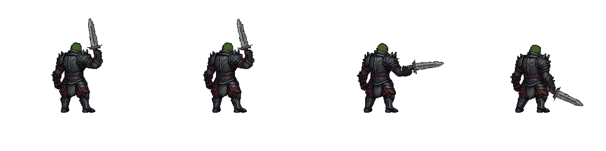

# Reparo local back_r/Sword — V8

Status: `TECHNICALLY_COMPLETE` / `VISUAL_REVIEW_REQUIRED` / `PENDING_CREATOR`.

Entrega: `characters/orc-v1/source/combat-recovery-v8/rear-fix/back_r-sword/clip.json`. Nenhuma integração no manifesto, nenhuma outra célula alterada, nenhum commit e nenhuma escrita no Unity.

## Verificação dos critérios

- 9 quadros armados distintos por SHA-256 e por pixels RGBA decodificados; nenhum par duplicado.
- Maior passo: **F05 → F06 = 73.2334 px**, dentro de 56–76 px; F06 → F07 = 57.9206 px.
- Grade preservada: 13 quadros / 730 ms; durações `[30,65,35,50,45,65,35,35,100,55,80,45,90]`; fases e janela armada F02–F10 idênticas à origem. Bookends desarmados F00/F01/F11/F12 byte-idênticos.
- **0 pixels claros de armadura apagados** (L = 0,299R + 0,587G + 0,114B ≥ 160). A origem back_r já contém zero desses pixels em todos os quadros; sua série `[0,0,0,0,0,0,0,0,0,0,0,0,0]` foi preservada. A referência back_l contém `[7, 7, 7, 9, 9, 9, 9, 8, 6, 12, 7, 7, 7]`. Não se afirma igualdade entre essas séries. Fechamento conforme esclarecimento do usuário: preservar os pixels claros existentes satisfaz este ponto.
- Zero pixels de arma abaixo de groundY=190. Em F02–F10 há interseção raster entre arma e luva handFront em todos os quadros; arma, luva e antebraço transformados juntos nos reparos. Inspeção ampliada local confirma ligação visual.
- Composição alfa-over das quatro camadas idêntica aos frames; native128 idêntico ao crop body[64:192,64:192]. Tempos lidos dos dois mestres .aseprite salvos; strips conferidos quadro a quadro.

## Procedência e decisões

Autoria **programática local no Aseprite 1.3.18.6**, via [author.lua](author.lua), sem IA/PixelLab. Imagens e mestres exportados pelo editor; Python usado apenas para medição, metadados e relatório. Fontes back_r herdadas preservadas. back_l/Sword V8 e front_r/Sword referenciado pelo V8 serviram de comparação visual para preparação, liberação e recuperação; nenhum pixel dessas vistas foi espelhado ou transplantado. Os doadores raster são da própria vista back_r e do mesmo item.

As únicas articulações novas são F05, F06 e F10; máscaras, pivôs e ângulos estão em author.lua e author-result.json. Restante do corpo preservado fora das máscaras locais. Não houve mudança de relógio nem redesenho integral.

| Quadro | Fase | ms | Pose usada e motivo |
|---|---|---:|---|
| F00 | rest | 30 | Repouso traseiro original F00, preservado para manter o bookend desarmado. |
| F01 | body-preparation | 65 | Preparação corporal original F01, preservada para manter a entrada desarmada. |
| F02 | establish-grip | 35 | Estabelecimento de pegada original F02, preservado com arma ligada à luva. |
| F03 | anticipation | 50 | Antecipação original F03, preservada como elevação anterior ao coil. |
| F04 | coil-behind | 45 | Coil original F04, preservado como início da preparação alta. |
| F05 | apex-hold | 65 | Ápice derivado de F05/F04: antebraço e luva articulados -4° em torno de (163,105), com a arma acompanhando; cria compressão distinta antes da liberação. |
| F06 | slash-release | 35 | Liberação derivada de F06: antebraço e luva articulados +18° em torno de (166,121), com a arma acompanhando; antecipa a aceleração para a fase slash-release. |
| F07 | contact | 35 | Contato original F07, preservado como término da descida acelerada. |
| F08 | follow-through | 100 | Follow-through original F08, preservado para manter a extensão após contato. |
| F09 | recoil | 55 | Recoil original F09, preservado como início da recuperação. |
| F10 | settle-grip | 80 | Settle derivado de F10/F09: antebraço e luva articulados -15° em torno de (162,135), com a arma acompanhando; cria recolhimento distinto antes de soltar a pegada. |
| F11 | release-grip | 45 | Liberação original F11, preservada como recuperação desarmada. |
| F12 | return-to-guard | 90 | Retorno à guarda original F12, preservado para manter o bookend desarmado. |

## SHA-256 dos 13 quadros compostos

| Quadro | SHA-256 |
|---|---|
| F00 | `ce98f5c5b5438e23eddbe05b2778cd8393086a82beb08db7e0936f7fed4608f9` |
| F01 | `acc71423458ffa27871479c57d236b534a3a542f7d0a561c14e8ef359e340f66` |
| F02 | `7ae2d6dba8041f39066db07104c374f2e30319e8cc5a92929d79106ce086983f` |
| F03 | `b918a15ee401d24c225d9e2e2beb8a59153cdfd0926011482a21914640a14500` |
| F04 | `fab4697e9544dca23a38844851f54ef4b54e006e6444c998b1ad6294bb24181c` |
| F05 | `0e4f7b03e4e67c1824e456afa33687e111cdfa9622d1a7496c520559005f3680` |
| F06 | `9d3855f708b5e5fb8035cf505339d63c65b49f296709b078527ad366ac1f92a0` |
| F07 | `2df7f2413fe26fc26994a11fb85cbf3fdcbfccf77c57b3f3d99d65eecd9fc68a` |
| F08 | `dabb68c26c4d7b6a06fb7e6c159ee4b3814e1c48cbf63e781739929e808d4076` |
| F09 | `ecc794e7c1f84f7c8138448db052904a42b46c7f760935baf330a7eb01d25eaf` |
| F10 | `82362e0ef295ea18b52f1bd9a52247c31a746e35e97235829381f02747add4c2` |
| F11 | `586533c3422f0429a9e7f7dc446a67de71f805f843bcac917940a8e4d57e72fb` |
| F12 | `89a105e2c378b98385479950fbb48583e27fab837ba903692d1381acbe25af97` |

## Centroide da lâmina e passos

Centroide geométrico dos pixels não transparentes de `weaponFront`, canvas composto 256×256, mesmo método que reproduz os valores do QA original. Transições sem lâmina nos dois extremos são N/A; surgimento e desaparecimento não são passos cinéticos.

| Transição | Centroide anterior (x,y) | Centroide seguinte (x,y) | Passo px |
|---|---|---|---:|
| F00 → F01 | — | — | N/A |
| F01 → F02 | — | (172.4668, 103.5350) | N/A |
| F02 → F03 | (172.4668, 103.5350) | (170.0485, 69.0557) | 34.5641 |
| F03 → F04 | (170.0485, 69.0557) | (156.4614, 60.4883) | 16.0626 |
| F04 → F05 | (156.4614, 60.4883) | (153.3333, 61.0735) | 3.1823 |
| F05 → F06 | (153.3333, 61.0735) | (207.2355, 110.6486) | 73.2334 |
| F06 → F07 | (207.2355, 110.6486) | (189.5170, 165.7925) | 57.9206 |
| F07 → F08 | (189.5170, 165.7925) | (184.5170, 172.7925) | 8.6023 |
| F08 → F09 | (184.5170, 172.7925) | (187.9443, 157.0485) | 16.1127 |
| F09 → F10 | (187.9443, 157.0485) | (192.7310, 149.5884) | 8.8637 |
| F10 → F11 | (192.7310, 149.5884) | — | N/A |
| F11 → F12 | — | — | N/A |

## Strip F04–F07 em 4×

Exportação Aseprite: 4096×1024, quatro canvases compostos de 256×256 ampliados em 4×.

Métricas completas: [metrics.json](metrics.json). Contrato, hashes das camadas, native e mestres: `characters/orc-v1/source/combat-recovery-v8/rear-fix/back_r-sword/clip.json`. Aprovação artística permanece reservada ao criador.
