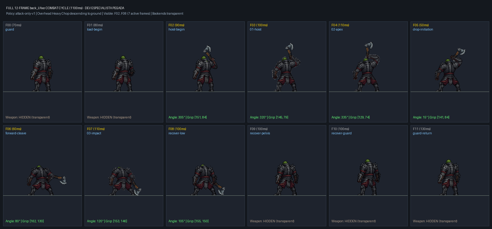
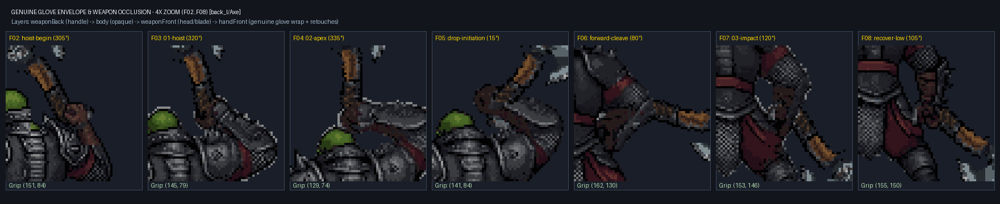
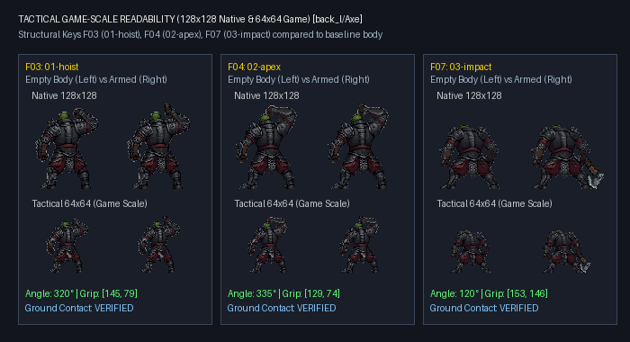

# Relatorio Tecnico de Autoria: back_l/Axe Ciclo Completo (12 Quadros, 1100ms)

> **Status:** `REAR_TWO_REMAINING_FULL_READY` | **Data:** 2026-10-29 | **Papel:** DEV ESPECIALISTA PEGADA (Gemini Flash Antigravity)
> **Fonte do Corpo Aprovada por QA:** `characters/orc-v1/source/combat-rescue-v5/body-specialist/glm-fixes/back_l-Axe-full/clip.json`
> **QA Independente Autorizador:** `863ae631-5582-4955-a0ef-020d51692fbb` (`READY_FOR_REAR_GRIPS`)
> **Proximo Passo:** Root submete ao MESMO revisor QA Copilot/Antigravity (`863ae631`). DEV para rigorosamente conforme acordado.

---

## 1. Resumo Executivo e Escopo Autorizado

Autorizado formalmente pelo Root apos veredito `READY_FOR_REAR_GRIPS` dos corpos reparados pela GLM pelo QA independente `863ae631-5582-4955-a0ef-020d51692fbb` (em `experiments/main-orc-combat-rescue-v5/qa-antigravity-flash/glm-body-fixes-result.json`), o DEV Especialista Pegada compos o **ciclo completo de 12 quadros de combate armado para `back_l/Axe`** (1100 ms), aplicando com rigor o metodo de 4 camadas e autoria Aseprite aprovado pelo QA.

### Compromissos Cumpridos com Rigor Absoluto:
1. **Zero alteracao de RGBA corporal (`bodyRgbaDelta == 0`):** Todos os 12 quadros corporais (256x256) em `layers/body/` sao **100% byte-identicos** ao corpo base de `glm-fixes/back_l-Axe-full/body256.aseprite`. Versoes nativas 128x128 possuem **0 pixel de discrepancia decodificada**.
2. **Preservacao das Chaves Estruturais F03, F04 e F07:** As poses-chave aprovadas (`01-hoist`, `02-apex`, `03-impact`) foram rigorosamente preservadas em suas camadas corporais e timing.
3. **Politica Estrita `attack-only-v1`:** Intervalo de visibilidade declarado estritamente em `[2, 8]` (F02..F08). Os quadros de guarda inicial (F00..F01) e termino/retorno a guarda (F09..F11) possuem camadas `weaponBack`, `weaponFront` e `handFront` 100% transparentes, com o composto byte-identico ao corpo base.
4. **Cinematica Natural e Coerente:** F02 (305°) -> F03 (320°) -> F04 (335°) -> F05 (15°) -> F06 (80°) -> F07 (120°) -> F08 (105°).
5. **Folga Correta com o Solo:** Blade edge touches groundY=190 (native 126) exactly at F07 impact without subterranean clipping; rebounds cleanly to y=188 at F08.
6. **Autoria 100% em Aseprite via Lua em Perfil Isolado:** Executado via `Aseprite 1.3.18.6 batch` sob o perfil exclusivo `tmp/aseprite-rear-grip-flash-profile`. 4 mestres Aseprite gerados, salvos, reabertos e reexportados.
7. **Zero Chamadas PixelLab / Sem Escrita Unity / Sem Git Commits:** Respeito integral aos limites do workspace.

---

## 2. Matriz Completa dos 12 Quadros (1100ms)

| Quadro | Fase | Duracao | Visibilidade | Angulo | Pega (x, y) | Chave / Reparo |
|:---:|:---|:---:|:---:|:---:|:---:|:---|
| **F00** | `guard` | 70 ms | Oculto | - | - | - |
| **F01** | `load-begin` | 80 ms | Oculto | - | - | - |
| **F02** | `hoist-begin` | 90 ms | Visivel | 305° | (151, 84) | REPARO GLM |
| **F03** | `01-hoist` | 100 ms | Visivel | 320° | (145, 79) | CHAVE ESTRUTURAL |
| **F04** | `02-apex` | 110 ms | Visivel | 335° | (129, 74) | CHAVE ESTRUTURAL |
| **F05** | `drop-initiation` | 50 ms | Visivel | 15° | (141, 84) | - |
| **F06** | `forward-cleave` | 60 ms | Visivel | 80° | (162, 130) | - |
| **F07** | `03-impact` | 110 ms | Visivel | 120° | (153, 146) | CHAVE ESTRUTURAL |
| **F08** | `recover-low` | 100 ms | Visivel | 105° | (155, 150) | - |
| **F09** | `recover-pelvis` | 100 ms | Oculto | - | - | - |
| **F10** | `recover-guard` | 100 ms | Oculto | - | - | - |
| **F11** | `guard-return` | 130 ms | Oculto | - | - | - |

---

## 3. Verificacao de Integridade e Hashes SHA-256 Oficiais

### 3.1 Mestres Aseprite e Tiras Canonicas

| Ativo | Caminho Relativo | SHA-256 |
|:---|:---|:---|
| **Mestre Composto 256 (4 camadas, 12f)** | `characters/orc-v1/source/combat-rescue-v5/rear-grip-flash/full-back-l-axe/source/composite.aseprite` | `a2ed1edcdf6dc3fdba68ec5ccb9742fd5868d1734f5e725e5a805eedf9d54a4c` |
| **Mestre Corpo 256 (1 camada, 12f)** | `characters/orc-v1/source/combat-rescue-v5/rear-grip-flash/full-back-l-axe/source/body.aseprite` | `bd39a6687551571ac0fe32143dda2c2e98143f9c30dc38ef1c6cb778884c9ddf` |
| **Mestre Luva/Mao 256 (1 camada, 12f)** | `characters/orc-v1/source/combat-rescue-v5/rear-grip-flash/full-back-l-axe/source/hand.aseprite` | `f86067488070e61b289bff9f8d246f18438b73b2839680df852517cacb953c08` |
| **Mestre Nativo 128 (1 camada, 12f)** | `characters/orc-v1/source/combat-rescue-v5/rear-grip-flash/full-back-l-axe/source/native.aseprite` | `c3d3d76606913bffb726efa8211a8eec9971a0da6ddcc8e81e50705ebd0251ab` |
| **Tira Composta 256 (3072x256)** | `characters/orc-v1/source/combat-rescue-v5/rear-grip-flash/full-back-l-axe/composite-strip.png` | `506a8f01814fcbdf2ed96365a73c286300cd63e166ed90d264f8131be48a1807` |
| **Tira Nativa Composta 128 (1536x128)** | `characters/orc-v1/source/combat-rescue-v5/rear-grip-flash/full-back-l-axe/native-composite-strip.png` | `905668ccc47f03e1a2b05a9733c005e1b0a9db6e44fd8e4e9e7187a2a8e79fc9` |
| **Tira Nativa Corpo 128 (1536x128)** | `characters/orc-v1/source/combat-rescue-v5/rear-grip-flash/full-back-l-axe/native-strip.png` | `0a59c724f0c796963195dfd1f601c309f526895bae093110bebaf547176780ea` |

### 3.2 Tabela Oficial de Hashes por Quadro

| Quadro | Composto 256 | Nativo Composto 128 | Nativo Corpo 128 |
|:---:|:---|:---|:---|
| **F00** | `0fb8c85ac00fddb016657c54a6180993ebc0c2db800e65cf57beb4f9e4aede19` | `2677b023bf5fa7e6f372465b5c9c54278e5cd55174577f989c18a6b0205caa8d` | `2677b023bf5fa7e6f372465b5c9c54278e5cd55174577f989c18a6b0205caa8d` |
| **F01** | `1391a5311e6e3617cf50e8a6d4f31b5fef48b730eb1617cd1443afc43b3c1bbf` | `6ad57722c39bcbffc2b81e5b212390c3ba5aed63b633eb4ea898077c265706e5` | `6ad57722c39bcbffc2b81e5b212390c3ba5aed63b633eb4ea898077c265706e5` |
| **F02** | `0084db99136ec3d34655ef105b651ae046129a09eb3a0fddb00763a17a8ababb` | `7385eb1f590ab33ef752452f49466f1b1d91afe734e04e6ecd28877e6f2ca31a` | `b7fb9ca300c73e8813f758f8bcd63c3cb99f288d2a291174a97ae39b6e919443` |
| **F03** | `90e3bea13dd34f147f1f5487222cd0de23cbe7726890ca6fc26acf82f31a2336` | `33652d0f86452b1800918cc16e1820deca134bb8041c83ad085f41e689aebcd1` | `d240b9ac537499625f7a86fcbfcf8cf2287b26947dc164092a76f313196c79ce` |
| **F04** | `8dfd92bc6f961bc939c16cb30445859ca9983cd22b6f2eb3a097754a4a64ec20` | `4cc91f79b2064dd172595b90a2d5781b688a4d608f1f7b00a4f05f9b54d0e1ee` | `7adfd9f45be25ce862d261f4bf6e47881e52043969605acf9cd4f918c9e00d56` |
| **F05** | `a40def0ebdbeeb1511f067bf985941190b1ff87dc1834260959a5320a075030e` | `71d81ab91f7872a14940e1b7a59431b2f9a6330572395e660d96ef514eec0be6` | `4e4357ff64f721a41671d9d27b1ae24258e25074f7605891cd0f0d9199bc51d0` |
| **F06** | `714bfda00a864ec022fd2d937d10aea06274fddd2d066089d3b61cf90de79485` | `246f0b76126e93fa018f7eb7e5974a8daa398ba38cd75b40d4d35e7d33070832` | `37a21fc93b33e08c1e6e4383c4e59817b910a7e73ea141ea2a0e6e08182ac31e` |
| **F07** | `9f6e83e84af9200a392d41e9904df7d9b191cd019129439f5cbf6d2a11a6b95e` | `d28232123c65eef08a8b860d8d4c93c677c6be32ea021d8eaa2613e77f1fb543` | `7a0c943c51f555f683ba78913150190e9b375a0091714644129b6fef7ea8c1a0` |
| **F08** | `87fd6b0d366949744fc1df9bc4a129f6e1886228b4f3c48acdf1acdb3ef98732` | `dbb1f7bca826b5210196b26ee4af74dc3a07a0adcc4edb113aadd96f6e4bb0b1` | `c1f4b59836cf1ee585b6c7b1c5bd9e7be44e0cdd50d84a1b4197d71abf9d4148` |
| **F09** | `c7882462aae760ec2b3803e3711c7b3efc6ec3f7a292ab09e53b7437b5659b8a` | `d5c31ed503a1fa8804c847adcf8e9e0f6c9fb552017c15b064b4ebf3a053ed3d` | `d5c31ed503a1fa8804c847adcf8e9e0f6c9fb552017c15b064b4ebf3a053ed3d` |
| **F10** | `684eaa6acec15e62554c4045d0a69c42430c048d626c65a5ea5b69879c07ff03` | `07b5e84b06466e833b2019bf42dce60e187f7adcb7b13de335a90e7cce9bf1d0` | `07b5e84b06466e833b2019bf42dce60e187f7adcb7b13de335a90e7cce9bf1d0` |
| **F11** | `0fb8c85ac00fddb016657c54a6180993ebc0c2db800e65cf57beb4f9e4aede19` | `2677b023bf5fa7e6f372465b5c9c54278e5cd55174577f989c18a6b0205caa8d` | `2677b023bf5fa7e6f372465b5c9c54278e5cd55174577f989c18a6b0205caa8d` |

---

## 4. Evidencia Visual e Analise Anatomica

### 4.1 Visao Geral da Trajetoria (12 Quadros)

### 4.2 Detalhe da Luva Genuina e Profundidade de Oclusao (F02..F08 em 4X Zoom)

### 4.3 Legibilidade na Escala Tatica do Jogo (128x128 e 64x64)

---

## 5. Verificacao dos Portoes de Qualidade (checks.json)

- **timing_preservation**: `PASS` &mdash; 12 frames totaling exactly 1100ms
- **body_zero_rgba_delta**: `PASS` &mdash; All 12 frames body256 are 100% byte-identical to GLM body-specialist; all 12 frames native body have 0 pixel difference
- **structural_keys_preservation**: `PASS` &mdash; Structural keys F03, F04, F07 byte-identical in body256 and 0 pixel diff in native128
- **attack_only_v1_policy**: `PASS` &mdash; Visible interval is strictly [2, 8]. Bookends F00, F01, F09, F10, F11 have 100% transparent weaponBack, weaponFront, handFront, and composite byte-matches body
- **kinematic_arc_continuity**: `PASS` &mdash; F02 (305°) -> F03 (320°) -> F04 (335°) -> F05 (15°) -> F06 (80°) -> F07 (120°) -> F08 (105°)
- **ground_contact_clearance**: `PASS` &mdash; Blade edge touches groundY=190 (native 126) exactly at F07 impact without subterranean clipping; rebounds cleanly to y=188 at F08
- **four_layer_aseprite_masters**: `PASS` &mdash; 4 masters saved, reopened, and verified
- **pixellab_generations**: `PASS` &mdash; 0 external API calls consumed; 100% local deterministic authoring
