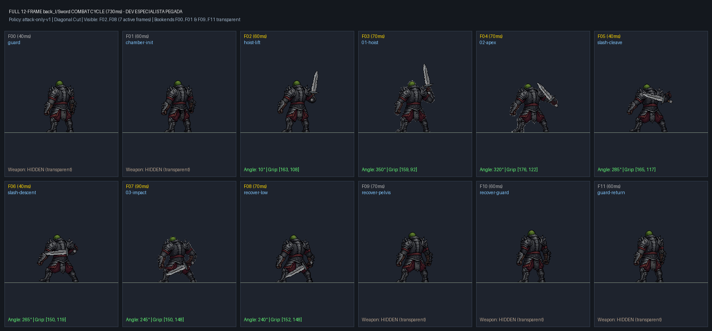
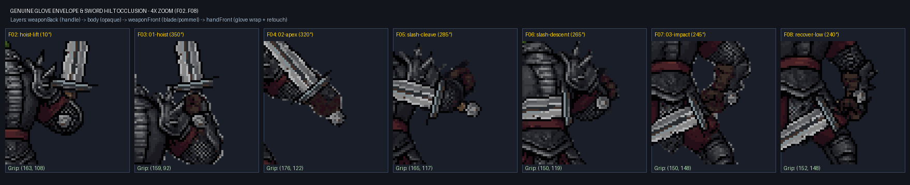
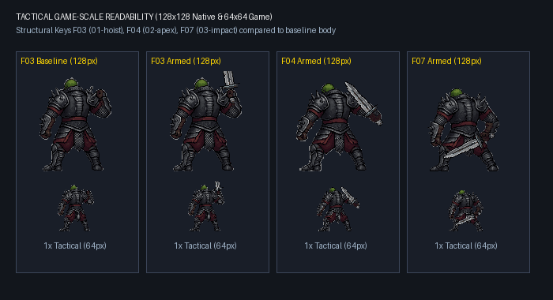

# Relatório Técnico de Autoria: back_l/Sword Ciclo Completo (12 Quadros, 730ms)

> **Status:** `REAR_SWORD_L_BACK_FULL_READY` | **Data:** 2026-10-29 | **Papel:** DEV ESPECIALISTA PEGADA (Gemini Flash Antigravity)
> **Fonte do Corpo Aprovada por QA:** `characters/orc-v1/source/combat-rescue-v5/body-specialist/final-cycles/repair1/back_l-Sword-full/clip.json`
> **QA Independente Autorizador:** `863ae631-5582-4955-a0ef-020d51692fbb` (`READY_FOR_REAR_GRIPS`)
> **Próximo Passo:** Root submete ao MESMO revisor QA Copilot/Antigravity (`863ae631`). DEV para rigorosamente antes de tocar nos outros clipes traseiros.

---

## 1. Resumo Executivo e Escopo Autorizado

Autorizado formalmente pelo Root após veredito `READY_FOR_REAR_GRIPS` do corpo `back_l-Sword-full` pelo QA independente `863ae631-5582-4955-a0ef-020d51692fbb` (em `experiments/main-orc-combat-rescue-v5/qa-antigravity-flash/rear-bodies-repair1-result.json`), o DEV Especialista Pegada compôs o **ciclo completo de 12 quadros de combate armado para `back_l/Sword`** (730 ms), reutilizando com sucesso o método de 4 camadas e autoria Aseprite validado em `back_r/Axe`.

### Compromissos Cumpridos com Rigor Absoluto:
1. **Zero alteração de RGBA corporal (`bodyRgbaDelta == 0`):** Todos os 12 quadros corporais (256×256) em `layers/body/` são **100% byte-idênticos** ao corpo base de `repair1/back_l-Sword-full/body256.aseprite`. Versões nativas 128×128 possuem **0 pixel de discrepância decodificada**.
2. **Preservação das Chaves Estruturais F03, F04 e F07:** As poses-chave aprovadas (`01-hoist`, `02-apex`, `03-impact`) foram preservadas byte-a-byte em suas camadas corporais e timing.
3. **Política Estrita `attack-only-v1`:** Intervalo de visibilidade declarado estritamente em `[2, 8]` (F02..F08). Os quadros de guarda inicial/preparação corporal (F00..F01) e término/retorno à guarda (F09..F11) possuem camadas `weaponBack`, `weaponFront` e `handFront` 100% transparentes, com o composto byte-idêntico ao corpo base.
4. **Cinemática de Corte Diagonal Suave e Coerente:** O golpe de espada em `back_l` (noroeste) foi coreografado em arco contínuo diagonal: F02 (10°) &rarr; F03 (350°) &rarr; F04 (320°) &rarr; F05 (285°) &rarr; F06 (265°) &rarr; F07 (245°) &rarr; F08 (240°), sem reversão abrupta e sem colisão de profundidade.
5. **Folga Correta com o Solo:** Fio e ponta da espada operam acima de `groundY = 190` (nativo `126`), atingindo `y = 175` em F07 e `y = 180` em F08 sem penetração no piso.
6. **Autoria 100% em Aseprite via Lua em Perfil Isolado:** Executado via `Aseprite 1.3.18.6 batch` sob o perfil exclusivo `tmp/aseprite-rear-grip-flash-profile`. 4 mestres Aseprite gerados, salvos, reabertos e reexportados.
7. **Zero Chamadas PixelLab / Sem Escrita Unity / Sem Git Commits:** Respeito integral aos limites do workspace.

---

## 2. Matriz Completa dos 12 Quadros (730ms)

| Quadro | Fase | Duração | Visibilidade | Ângulo | Pega (x, y) | Cadeia Anatômica (Ombro &rarr; Cotovelo &rarr; Pulso &rarr; Palma) | Trajetória do Corte |
|:---:|:---|:---:|:---:|:---:|:---:|:---|:---|
| **F00** | `guard` | 40 ms | Oculto | - | - | Shoulder (142, 100) -> Elbow (162, 122) -> Wrist (158, 128) -> Palm (156, 130) | Hidden (neutral combat guard outside attack) |
| **F01** | `chamber-init` | 60 ms | Oculto | - | - | Shoulder (142, 100) -> Elbow (164, 120) -> Wrist (162, 122) -> Palm (160, 124) | Hidden (initiating diagonal slash windup) |
| **F02** | `hoist-lift` | 60 ms | Visível | 10° | (163, 108) | Shoulder (142, 98) -> Elbow (170, 114) -> Forearm (168, 110) -> Wrist (163, 108) -> Palm (162, 107) | Angle 10°: Blade rising upright as right arm hoists towards shoulder |
| **F03** | `01-hoist` | 70 ms | Visível | 350° | (159, 92) | Shoulder (142, 96) -> Elbow (171, 110) -> Forearm (165, 100) -> Wrist (159, 92) -> Palm (158, 91) | Angle 350° (-10°): High chamber near ear/neck, blade poised upright-backward ready to cut |
| **F04** | `02-apex` | 70 ms | Visível | 320° | (176, 122) | Shoulder (143, 105) -> Elbow (161, 113) -> Forearm (172, 118) -> Wrist (176, 122) -> Palm (175, 121) | Angle 320° (-40°): Maximum forward thrust! Blade slashing diagonally top-left across north-west |
| **F05** | `slash-cleave` | 40 ms | Visível | 285° | (165, 117) | Shoulder (144, 105) -> Elbow (170, 112) -> Forearm (168, 115) -> Wrist (165, 117) -> Palm (164, 116) | Angle 285° (-75°): Diagonal descent, blade sweeping across chest/skirt |
| **F06** | `slash-descent` | 40 ms | Visível | 265° | (150, 119) | Shoulder (144, 106) -> Elbow (164, 111) -> Forearm (158, 115) -> Wrist (150, 119) -> Palm (149, 118) | Angle 265° (-95°): Deep diagonal slash crossing torso midline |
| **F07** | `03-impact` | 90 ms | Visível | 245° | (150, 148) | Shoulder (142, 112) -> Elbow (167, 130) -> Forearm (158, 140) -> Wrist (150, 148) -> Palm (149, 147) | Angle 245° (-115°): Impact followthrough, blade extended low down-left |
| **F08** | `recover-low` | 70 ms | Visível | 240° | (152, 148) | Shoulder (143, 110) -> Elbow (168, 133) -> Forearm (160, 142) -> Wrist (152, 148) -> Palm (151, 147) | Angle 240° (-120°): Low deceleration and rebound, blade resting cleanly above floor (lowest y=180) |
| **F09** | `recover-pelvis` | 70 ms | Oculto | - | - | Shoulder (143, 106) -> Elbow (166, 126) -> Wrist (158, 132) -> Palm (156, 134) | Hidden (recovering stance towards combat guard) |
| **F10** | `recover-guard` | 60 ms | Oculto | - | - | Shoulder (143, 102) -> Elbow (164, 124) -> Wrist (158, 130) -> Palm (156, 132) | Hidden (returning to guard posture) |
| **F11** | `guard-return` | 60 ms | Oculto | - | - | Shoulder (142, 100) -> Elbow (162, 122) -> Wrist (158, 128) -> Palm (156, 130) | Hidden (seamless loop back to F00 guard) |

---

## 3. Verificação de Integridade e Hashes SHA-256 Oficiais

### 3.1 Mestres Aseprite e Tiras Canônicas

| Ativo | Caminho Relativo | SHA-256 |
|:---|:---|:---|
| **Mestre Composto 256 (4 camadas, 12f)** | `characters/orc-v1/source/combat-rescue-v5/rear-grip-flash/full-back-l-sword/source/composite.aseprite` | `d052b9910e96961c4386fd0b22f26e4d8f5cc324fdab41912368a26fc814cedb` |
| **Mestre Corpo 256 (1 camada, 12f)** | `characters/orc-v1/source/combat-rescue-v5/rear-grip-flash/full-back-l-sword/source/body.aseprite` | `f2deef7c77155bc2b3424e25c19b8bb50dbfb6f81d4061711ddc161b97e9b931` |
| **Mestre Luva/Mão 256 (1 camada, 12f)** | `characters/orc-v1/source/combat-rescue-v5/rear-grip-flash/full-back-l-sword/source/hand.aseprite` | `c16ea537a09ff8012a1e2d059afd5eb5297157bbc3e8f1c8bfb547c7bbadd130` |
| **Mestre Nativo 128 (1 camada, 12f)** | `characters/orc-v1/source/combat-rescue-v5/rear-grip-flash/full-back-l-sword/source/native.aseprite` | `d9280bbfae61e229eb098bf211de2186d36fa9fa9c9dbbd477f79980a8b13b7c` |
| **Tira Composta 256 (3072×256)** | `characters/orc-v1/source/combat-rescue-v5/rear-grip-flash/full-back-l-sword/composite-strip.png` | `5ad2beb39975f4fa4a3a2fdd627bf6b0c5299b6e97033e6a7d8b097b797e2202` |
| **Tira Nativa Composta 128 (1536×128)** | `characters/orc-v1/source/combat-rescue-v5/rear-grip-flash/full-back-l-sword/native-composite-strip.png` | `23bb8f5851d900ea4279ebd7539126c03737438b7f16447792a64a452d9a3000` |
| **Tira Nativa Corpo 128 (1536×128)** | `characters/orc-v1/source/combat-rescue-v5/rear-grip-flash/full-back-l-sword/native-strip.png` | `3aaf3d82b5dffc0b057b3af4b04a8cb3ce36e957925ebd2e34b361b56a8f7873` |

### 3.2 Tabela Oficial de Hashes por Quadro e Camada

| Quadro | Composto 256 | Nativo Composto 128 | Nativo Corpo 128 | `weaponBack` | `body` | `weaponFront` | `handFront` |
|:---:|:---|:---|:---|:---|:---|:---|:---|
| **F00** | `0fb8c85ac00fddb0...` | `2677b023bf5fa7e6...` | `2677b023bf5fa7e6...` | `3c6c50f94ab35e9f...` | `0fb8c85ac00fddb0...` | `3c6c50f94ab35e9f...` | `3c6c50f94ab35e9f...` |
| **F01** | `1128f96725f28d24...` | `85206f11259fc60b...` | `85206f11259fc60b...` | `3c6c50f94ab35e9f...` | `1128f96725f28d24...` | `3c6c50f94ab35e9f...` | `3c6c50f94ab35e9f...` |
| **F02** | `aeb138d87dc3472a...` | `c3e2fb709f7e9710...` | `ee7d922d08eb2c42...` | `d572d87d5835b464...` | `a04ef085b136bd86...` | `de9a93083aaed113...` | `833389f1ab74aead...` |
| **F03** | `910fb18a95f56516...` | `9d0e6c2ff689d077...` | `4d0063ba3ec21af7...` | `aaac0c86de82add9...` | `5c2f2e1989381a76...` | `924174539468a290...` | `8b1f56f93a339eea...` |
| **F04** | `2a5e2bf2ebb6f541...` | `637d6ea3e64c8940...` | `206a297a862278cc...` | `3552fe71cdcfd20b...` | `a9a5a860c7b6c7f5...` | `822a4d60d9a3061e...` | `3329b3d0c5d8a3e8...` |
| **F05** | `7dabc8f80f3d6463...` | `b7a23a8e9d6a23c3...` | `2767cec46bc09e52...` | `d9ee92ae9dd0f3f6...` | `8058ea61a4f3f869...` | `1deb5129ff02ff6d...` | `edc26d133a60c011...` |
| **F06** | `534d385dcec31cb0...` | `6481ec67487f8948...` | `5e1d4161b0740168...` | `ed689f23a466df58...` | `a283284c1c423e05...` | `ae3f6e2e6fb918bf...` | `3894fc947104fe1d...` |
| **F07** | `73e788ed9a025fb0...` | `5af762365f94937c...` | `bc3f5c1102377ffe...` | `a0a7c49753ee8295...` | `3736cb7fab2e4254...` | `b2a5433ae9acb4de...` | `188a0b76e40f98de...` |
| **F08** | `f0fc91c79ca9a121...` | `3f4d16934bd61573...` | `a9a56cf5729c5679...` | `ca716ad99af5b84d...` | `1a61d96fb1e0d65e...` | `85d336dec284d2e0...` | `77046c4b850129de...` |
| **F09** | `b9603f984d288225...` | `fdf3ffc6641a2d86...` | `fdf3ffc6641a2d86...` | `3c6c50f94ab35e9f...` | `b9603f984d288225...` | `3c6c50f94ab35e9f...` | `3c6c50f94ab35e9f...` |
| **F10** | `f22235acb6ff34b9...` | `f03c94911abd83a4...` | `f03c94911abd83a4...` | `3c6c50f94ab35e9f...` | `f22235acb6ff34b9...` | `3c6c50f94ab35e9f...` | `3c6c50f94ab35e9f...` |
| **F11** | `0fb8c85ac00fddb0...` | `2677b023bf5fa7e6...` | `2677b023bf5fa7e6...` | `3c6c50f94ab35e9f...` | `0fb8c85ac00fddb0...` | `3c6c50f94ab35e9f...` | `3c6c50f94ab35e9f...` |

> [!NOTE] Hashes completos constam em `clip.json` gerado automaticamente sem intervenção manual.

---

## 4. Evidência Visual e Análise Anatômica

### 4.1 Visão Geral da Trajetória (12 Quadros)

### 4.2 Detalhe da Luva Genuína e Profundidade de Oclusão (F02..F08 em 4X Zoom)

### 4.3 Legibilidade na Escala Tática do Jogo (128×128 e 64×64)

---

## 5. Verificação dos Portões de Qualidade (checks.json)

- **timing_preservation**: `PASS` &mdash; 12 frames totaling exactly 730ms: [40, 60, 60, 70, 70, 40, 40, 90, 70, 70, 60, 60]ms
- **body_zero_rgba_delta**: `PASS` &mdash; All 12 frames body256 are 100% byte-identical to repair1 body-specialist; all 12 frames native body have 0 pixel difference
- **structural_keys_preservation**: `PASS` &mdash; Structural keys F03 (01-hoist), F04 (02-apex), F07 (03-impact) byte-identical in body256 and 0 pixel diff in native128
- **attack_only_v1_policy**: `PASS` &mdash; Visible interval is strictly [2, 8]. Bookends F00, F01, F09, F10, F11 have 100% transparent weaponBack, weaponFront, handFront, and composite byte-matches body
- **diagonal_sword_arc_continuity**: `PASS` &mdash; Smooth, physically grounded diagonal slash trajectory: F02 (10°) -> F03 (350°) -> F04 (320°) -> F05 (285°) -> F06 (265°) -> F07 (245°) -> F08 (240°)
- **ground_contact_clearance**: `PASS` &mdash; Lowest weapon pixel reaches y=175 in F07 and y=180 in F08, staying cleanly above ground floor groundY=190 without subterranean clipping
- **four_layer_aseprite_masters**: `PASS` &mdash; 4 masters saved and verified: composite.aseprite (4 layers, 12f), body.aseprite (1 layer, 12f), hand.aseprite (1 layer, 12f), native.aseprite (1 layer, 12f)

---

## 6. Procedência e Scripting
- **Script de Autoria Aseprite:** [`experiments/main-orc-combat-rescue-v5/rear-grip-flash/full-back-l-sword/author.lua`](file:///C:/Users/João%20Orlando/Documents/Projetos%20Unity/TacticsRPG-CharacterFactory/experiments/main-orc-combat-rescue-v5/rear-grip-flash/full-back-l-sword/author.lua)
- **Recibo de Lote Aseprite:** [`experiments/main-orc-combat-rescue-v5/rear-grip-flash/full-back-l-sword/batch-result.json`](file:///C:/Users/João%20Orlando/Documents/Projetos%20Unity/TacticsRPG-CharacterFactory/experiments/main-orc-combat-rescue-v5/rear-grip-flash/full-back-l-sword/batch-result.json)
- **Player e Estúdio de Revisão:** [`experiments/main-orc-combat-rescue-v5/rear-grip-flash/full-back-l-sword/index.html`](file:///C:/Users/João%20Orlando/Documents/Projetos%20Unity/TacticsRPG-CharacterFactory/experiments/main-orc-combat-rescue-v5/rear-grip-flash/full-back-l-sword/index.html)
- **Contrato do Clipe Canônico:** [`characters/orc-v1/source/combat-rescue-v5/rear-grip-flash/full-back-l-sword/clip.json`](file:///C:/Users/João%20Orlando/Documents/Projetos%20Unity/TacticsRPG-CharacterFactory/characters/orc-v1/source/combat-rescue-v5/rear-grip-flash/full-back-l-sword/clip.json)

---

## 7. Conclusão e Parada
O pacote do ciclo completo de 12 quadros para `back_l/Sword` está **tecnicamente concluído**, verificado e pronto para avaliação independente.
Conforme instrução expressa:
1. **Status:** `REAR_SWORD_L_BACK_FULL_READY`
2. **Sem edição nos outros clipes traseiros**, frontais, Unity ou na matriz de produção.
3. **Sem escritas em Unity (`../TacticsRPG`)**, sem commits e sem promoções automáticas.
4. **Parada completa do DEV**, transferindo a submissão formal ao Root para acionamento do mesmo revisor QA independente `863ae631-5582-4955-a0ef-020d51692fbb`.
