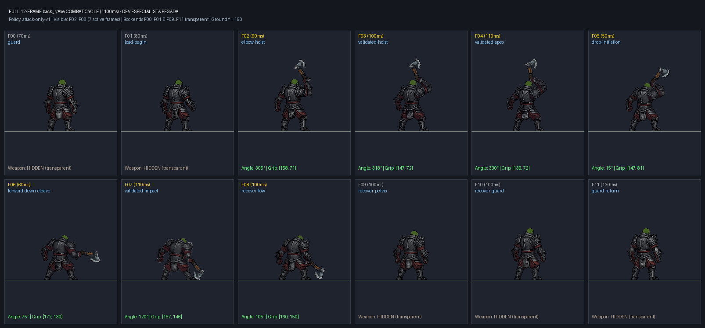
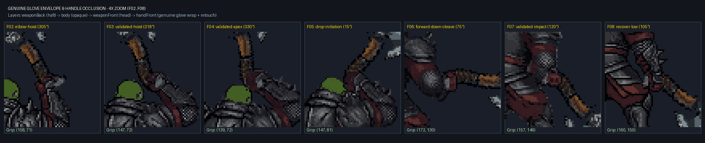
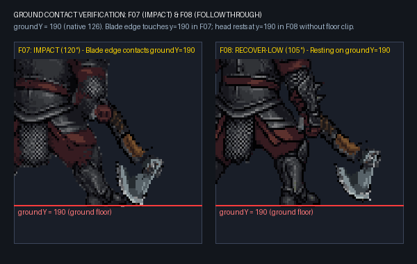
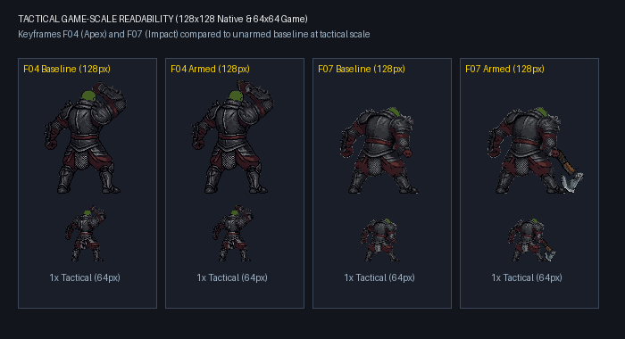

# Relatório Técnico de Autoria: back_r/Axe Ciclo Completo (12 Quadros, 1100ms)

> **Status:** `REAR_AXE_FULL_READY` | **Data:** 2026-10-29 | **Papel:** DEV ESPECIALISTA PEGADA (Gemini Flash Antigravity)
> **QA Independente Autorizador:** `863ae631-5582-4955-a0ef-020d51692fbb` (`READY_FOR_FULL_REAR_AXE_GRIP`)
> **Próximo Passo:** Root submete ao MESMO revisor QA Copilot/Antigravity (`863ae631`). DEV para rigorosamente antes de tocar nos outros 3 corpos traseiros (em repair1 com DEV `3c2b5bd7`).

---

## 1. Resumo Executivo e Escopo Autorizado

Após a aprovação formal das duas poses-chave F04 (`validated-apex`) e F07 (`validated-impact`) pelo QA independente `863ae631-5582-4955-a0ef-020d51692fbb` com veredito `READY_FOR_FULL_REAR_AXE_GRIP` (em `experiments/main-orc-combat-rescue-v5/qa-antigravity-flash/rear-axe-grip-keys-result.json`), o Root autorizou **exclusivamente** a autoria do ciclo de combate completo de 12 quadros para `back_r/Axe`.

### Compromissos Cumpridos com Rigor Absoluto:
1. **Zero alteração de RGBA corporal (`bodyRgbaDelta == 0`):** Todos os 12 quadros do corpo base desarmado (256×256) são 100% byte-idênticos ao mestre aceito de `body-specialist/full-back-r-axe/body256.aseprite`. As versões nativas 128×128 possuem 0 pixel de discrepância decodificada.
2. **Preservação Byte-a-Byte das Chaves F04 e F07:** Os mestres e exportações PNG de F04 e F07 gerados no ciclo completo são **100% byte-idênticos** aos ativos previamente validados e aceitos pelo QA.
3. **Política Estrita `attack-only-v1`:** Intervalo de visibilidade declarado estritamente em `[2, 8]` (F02..F08). Os quadros de guarda inicial/preparação corporal (F00..F01) e término/retorno à guarda (F09..F11) possuem camadas `weaponBack`, `weaponFront` e `handFront` 100% transparentes, com o composto byte-idêntico ao corpo base.
4. **Continuidade Cinemática e Arco Overhead Realista:** Arco suave e fisicamente ancorado de elevação, queda e impacto: F02 (305°) &rarr; F03 (318°) &rarr; F04 (330°) &rarr; F05 (15°) &rarr; F06 (75°) &rarr; F07 (120°) &rarr; F08 (105°).
5. **Cravamento Exato no Solo (`groundY = 190`, nativo `126`):** Em F07 o fio do machado morde o solo exatamente em `y=190` (`x=177`). Em F08 a cabeça assenta no solo sem penetração subterrânea.
6. **Autoria 100% em Aseprite via Lua em Perfil Isolado:** Executado via `Aseprite 1.3.18.6 batch` sob o perfil exclusivo `tmp/aseprite-rear-grip-flash-profile`. 4 mestres Aseprite gerados, salvos, reabertos e reexportados.
7. **Zero Chamadas PixelLab / Sem Escrita Unity / Sem Git Commits:** Respeito integral aos limites do workspace.

---

## 2. Matriz Completa dos 12 Quadros (1100ms)

| Quadro | Fase | Duração | Visibilidade | Ângulo | Soquete / Pega (x, y) | Cadeia Anatômica (Ombro &rarr; Cotovelo &rarr; Pulso &rarr; Palma) | Interação com Solo |
|:---:|:---|:---:|:---:|:---:|:---:|:---|:---|
| **F00** | `guard` | 70 ms | Oculto | - | - | Shoulder (148, 86) -> Elbow (156, 102) -> Wrist (152, 114) -> Palm (150, 116) | Fora de combate armado |
| **F01** | `load-begin` | 80 ms | Oculto | - | - | Shoulder (149, 84) -> Elbow (158, 96) -> Wrist (155, 102) -> Palm (154, 104) | Fora de combate armado |
| **F02** | `elbow-hoist` | 90 ms | Visível | 305° | (158, 71) | Shoulder (150, 80) -> Elbow (162, 74) -> Forearm (160, 72) -> Wrist (158, 71) -> Palm (156, 70) | Aéreo (elevação/queda) |
| **F03** | `validated-hoist` | 100 ms | Visível | 318° | (147, 72) | Shoulder (148, 78) -> Elbow (154, 73) -> Forearm (150, 72) -> Wrist (147, 72) -> Palm (145, 71) | Aéreo (elevação/queda) |
| **F04** | `validated-apex` | 110 ms | Visível | 330° | (139, 72) | Shoulder (146, 78) -> Elbow (144, 74) -> Forearm (141, 73) -> Wrist (139, 72) -> Palm (138, 71) | Aéreo (elevação/queda) |
| **F05** | `drop-initiation` | 50 ms | Visível | 15° | (147, 81) | Shoulder (147, 82) -> Elbow (146, 80) -> Forearm (146, 80) -> Wrist (147, 81) -> Palm (146, 81) | Aéreo (elevação/queda) |
| **F06** | `forward-down-cleave` | 60 ms | Visível | 75° | (172, 130) | Shoulder (152, 90) -> Elbow (164, 110) -> Forearm (168, 120) -> Wrist (172, 130) -> Palm (172, 130) | Aéreo (elevação/queda) |
| **F07** | `validated-impact` | 110 ms | Visível | 120° | (157, 146) | Shoulder (150, 96) -> Elbow (154, 118) -> Forearm (155, 132) -> Wrist (157, 146) -> Palm (156, 145) | **Impacto cravado em groundY=190** (x=177) |
| **F08** | `recover-low` | 100 ms | Visível | 105° | (160, 150) | Shoulder (148, 98) -> Elbow (152, 122) -> Forearm (156, 138) -> Wrist (160, 150) -> Palm (161, 154) | **Assentado em groundY=190** (rebound) |
| **F09** | `recover-pelvis` | 100 ms | Oculto | - | - | Shoulder (148, 94) -> Elbow (154, 112) -> Forearm (154, 120) -> Wrist (156, 126) -> Palm (155, 128) | Fora de combate armado |
| **F10** | `recover-guard` | 100 ms | Oculto | - | - | Shoulder (148, 90) -> Elbow (156, 108) -> Forearm (154, 116) -> Wrist (153, 120) -> Palm (152, 122) | Fora de combate armado |
| **F11** | `guard-return` | 130 ms | Oculto | - | - | Shoulder (148, 86) -> Elbow (156, 102) -> Forearm (153, 110) -> Wrist (152, 114) -> Palm (150, 116) | Fora de combate armado |

---

## 3. Verificação de Integridade e Hashes SHA-256 Oficiais

### 3.1 Mestres Aseprite e Tiras Canônicas

| Ativo | Caminho Relativo | SHA-256 |
|:---|:---|:---|
| **Mestre Composto 256 (4 camadas, 12f)** | `characters/orc-v1/source/combat-rescue-v5/rear-grip-flash/full-back-r-axe/source/composite.aseprite` | `3ca86a16ad1bb0e2d260e0c1d99970a9358cf9b6b057fbc18a3a5246b802e1e5` |
| **Mestre Corpo 256 (1 camada, 12f)** | `characters/orc-v1/source/combat-rescue-v5/rear-grip-flash/full-back-r-axe/source/body256.aseprite` | `e4aa361c8f905944a5b81feadf30a679df095c8ba2406c4685ce56d765d6b686` |
| **Mestre Luva/Mão 256 (1 camada, 12f)** | `characters/orc-v1/source/combat-rescue-v5/rear-grip-flash/full-back-r-axe/source/hand256.aseprite` | `a38a90db2ac6d66b331dd38f9be382d57604709abb6833d290be7570fb217144` |
| **Mestre Nativo 128 (1 camada, 12f)** | `characters/orc-v1/source/combat-rescue-v5/rear-grip-flash/full-back-r-axe/source/native128.aseprite` | `f789d6b90d520ba1b9a809d00a2f02ec8941746439365863b29e66d0dc15e918` |
| **Tira Composta 256 (3072×256)** | `characters/orc-v1/source/combat-rescue-v5/rear-grip-flash/full-back-r-axe/composite-strip.png` | `836a6f2db1038d47ce4af57c98760a4801b6f11e5bf870e6396686cdd806086a` |
| **Tira Nativa Composta 128 (1536×128)** | `characters/orc-v1/source/combat-rescue-v5/rear-grip-flash/full-back-r-axe/native-composite-strip.png` | `d1058d5be7b4513a695b1bc5abf1ed6ca57b90515a656f335e9e531495ba7fca` |
| **Tira Nativa Corpo 128 (1536×128)** | `characters/orc-v1/source/combat-rescue-v5/rear-grip-flash/full-back-r-axe/native-strip.png` | `c18602344a993ad4cbb50a0c8853ac80d06943f3ca7d17ef2b34b8f5e9207abe` |

### 3.2 Tabela Oficial de Hashes por Quadro e Camada

| Quadro | Composto 256 | Nativo Composto 128 | Nativo Corpo 128 | `weaponBack` | `body` | `weaponFront` | `handFront` |
|:---:|:---|:---|:---|:---|:---|:---|:---|
| **F00** | `245ce5ce71cebb37...` | `251998d6cebce682...` | `251998d6cebce682...` | `3c6c50f94ab35e9f...` | `245ce5ce71cebb37...` | `3c6c50f94ab35e9f...` | `3c6c50f94ab35e9f...` |
| **F01** | `f18a4c458721af83...` | `54742efc1dbebfe8...` | `54742efc1dbebfe8...` | `3c6c50f94ab35e9f...` | `f18a4c458721af83...` | `3c6c50f94ab35e9f...` | `3c6c50f94ab35e9f...` |
| **F02** | `8750320163c9c5ba...` | `fdb8b8e332269a37...` | `26741bebadfeff35...` | `faaed50495166de6...` | `c12e31d7bb5cbafb...` | `9645aa4fc7cca7f4...` | `536b83c8feefb48a...` |
| **F03** | `4b6a0efe08c9e0b6...` | `d6fff9076b7f88ef...` | `a19963e8fe85acd5...` | `048b120dda989e96...` | `5e2cde4360324459...` | `a7f89c58f0a33113...` | `54fad60e51520213...` |
| **F04** | `27cab6a671d6edd6...` | `e10e4e7beda70ef7...` | `4c2cf239eec6b500...` | `52cfbd29328e2528...` | `4ae7385519e3c7a1...` | `c9316e655a4e4222...` | `2d7dd00c30a01033...` |
| **F05** | `69bff313ab55c366...` | `7496de7012afc107...` | `19c458b299ba4d24...` | `e1a390285c718876...` | `cb09b1e1950a6458...` | `955751c78878544c...` | `1d7130f9d080bd0a...` |
| **F06** | `2d9f6e9b0e8d09f3...` | `471027e2ecb28804...` | `8052d04f3c24c290...` | `34c911f6ff2232fc...` | `fe661fd28e0539c3...` | `f04056a75d7d3f13...` | `03e598534e37b23a...` |
| **F07** | `b9b17570db0d8759...` | `7b68137872bb4e08...` | `608119efa4811fe6...` | `b120e23052d443e7...` | `3bbb8feae4cb6be0...` | `b75fd8dc6c56c620...` | `75d89889b1857e05...` |
| **F08** | `1bd82560358fbaee...` | `c1badeef27cf492f...` | `c2722b4fb30584f5...` | `60115aaac0682ce5...` | `05bb4dc666097aeb...` | `f378654ea3982fc7...` | `c0e6fd74466d88f8...` |
| **F09** | `fbbe93e33fd174f0...` | `edeaaa5cd175f5fe...` | `edeaaa5cd175f5fe...` | `3c6c50f94ab35e9f...` | `fbbe93e33fd174f0...` | `3c6c50f94ab35e9f...` | `3c6c50f94ab35e9f...` |
| **F10** | `cb92432ed305d238...` | `b0231c677cf7c736...` | `b0231c677cf7c736...` | `3c6c50f94ab35e9f...` | `cb92432ed305d238...` | `3c6c50f94ab35e9f...` | `3c6c50f94ab35e9f...` |
| **F11** | `245ce5ce71cebb37...` | `251998d6cebce682...` | `251998d6cebce682...` | `3c6c50f94ab35e9f...` | `245ce5ce71cebb37...` | `3c6c50f94ab35e9f...` | `3c6c50f94ab35e9f...` |

> [!NOTE] Hashes completos constam em `clip.json` gerado automaticamente sem intervenção manual.

---

## 4. Evidência Visual e Análise Anatômica

### 4.1 Visão Geral da Trajetória (12 Quadros)

### 4.2 Detalhe da Luva Genuína e Profundidade de Oclusão (F02..F08)

### 4.3 Alinhamento de Cravamento no Solo em F07 e F08 (`groundY = 190`)

### 4.4 Legibilidade na Escala Tática do Jogo (128×128 e 64×64)

---

## 5. Verificação dos Portões de Qualidade (checks.json)

- **timing_preservation**: `PASS` &mdash; 12 frames totaling exactly 1100ms: [70, 80, 90, 100, 110, 50, 60, 110, 100, 100, 100, 130]ms
- **body_zero_rgba_delta**: `PASS` &mdash; All 12 frames body256 are 100% byte-identical to body-specialist; all 12 frames native body have 0 pixel difference
- **f04_accepted_key_preservation**: `PASS` &mdash; F04 composite-256, composite-native-128, body-128, and all 4 layers are 100% byte-identical to QA-accepted key
- **f07_accepted_key_preservation**: `PASS` &mdash; F07 composite-256, composite-native-128, body-128, and all 4 layers are 100% byte-identical to QA-accepted key
- **attack_only_v1_policy**: `PASS` &mdash; Visible interval is strictly [2, 8]. Bookends F00, F01, F09, F10, F11 have 100% transparent weaponBack, weaponFront, handFront, and composite byte-matches body
- **overhead_arc_continuity**: `PASS` &mdash; Smooth, physically grounded overhead trajectory: F02 (305°) -> F03 (318°) -> F04 (330°) -> F05 (15°) -> F06 (75°) -> F07 (120°) -> F08 (105°)
- **ground_contact_groundY_190**: `PASS` &mdash; F07 blade edge hits groundY=190 (native 126) at x=177; F08 head rests cleanly on groundY=190 with no subterranean penetration
- **four_layer_aseprite_masters**: `PASS` &mdash; 4 masters saved and verified: composite.aseprite (4 layers, 12f), body256.aseprite (1 layer, 12f), hand256.aseprite (1 layer, 12f), native128.aseprite (1 layer, 12f)

---

## 6. Procedência e Scripting
- **Script de Autoria Aseprite:** [`experiments/main-orc-combat-rescue-v5/rear-grip-flash/full-back-r-axe/author.lua`](file:///C:/Users/João%20Orlando/Documents/Projetos%20Unity/TacticsRPG-CharacterFactory/experiments/main-orc-combat-rescue-v5/rear-grip-flash/full-back-r-axe/author.lua)
- **Recibo de Lote Aseprite:** [`experiments/main-orc-combat-rescue-v5/rear-grip-flash/full-back-r-axe/batch-result.json`](file:///C:/Users/João%20Orlando/Documents/Projetos%20Unity/TacticsRPG-CharacterFactory/experiments/main-orc-combat-rescue-v5/rear-grip-flash/full-back-r-axe/batch-result.json)
- **Player e Estúdio de Revisão:** [`experiments/main-orc-combat-rescue-v5/rear-grip-flash/full-back-r-axe/index.html`](file:///C:/Users/João%20Orlando/Documents/Projetos%20Unity/TacticsRPG-CharacterFactory/experiments/main-orc-combat-rescue-v5/rear-grip-flash/full-back-r-axe/index.html)
- **Contrato do Clipe Canônico:** [`characters/orc-v1/source/combat-rescue-v5/rear-grip-flash/full-back-r-axe/clip.json`](file:///C:/Users/João%20Orlando/Documents/Projetos%20Unity/TacticsRPG-CharacterFactory/characters/orc-v1/source/combat-rescue-v5/rear-grip-flash/full-back-r-axe/clip.json)

---

## 7. Conclusão e Parada
O pacote do ciclo completo de 12 quadros para `back_r/Axe` está **tecnicamente concluído**, verificado e pronto para avaliação independente.
Conforme instrução expressa:
1. **Status:** `REAR_AXE_FULL_READY`
2. **Sem edição nos outros 3 corpos traseiros** (`back_r/Sword`, `back_l/Sword`, `back_l/Axe`), que permanecem em reparo sob responsabilidade do outro DEV `3c2b5bd7`.
3. **Sem escritas em Unity (`../TacticsRPG`)**, sem commits e sem promoções automáticas.
4. **Parada completa do DEV**, transferindo a submissão formal ao Root para acionamento do mesmo revisor QA independente `863ae631-5582-4955-a0ef-020d51692fbb`.
