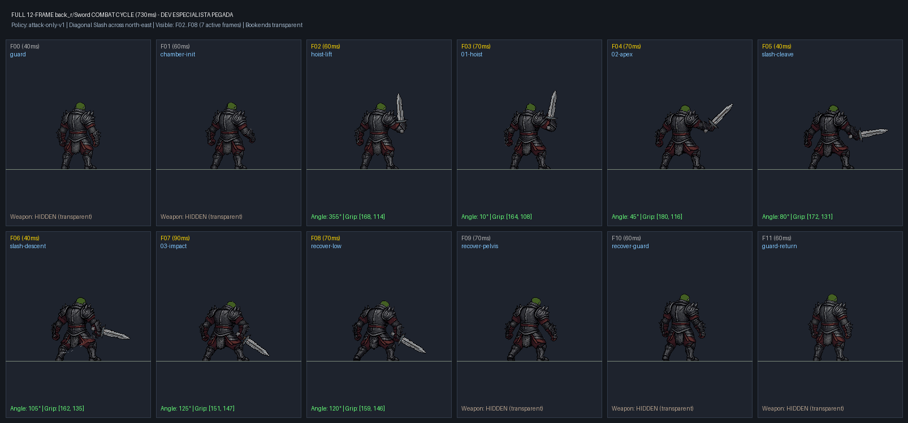
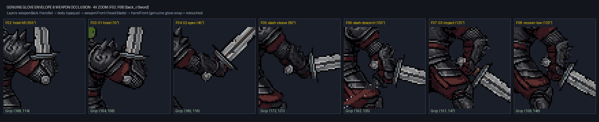
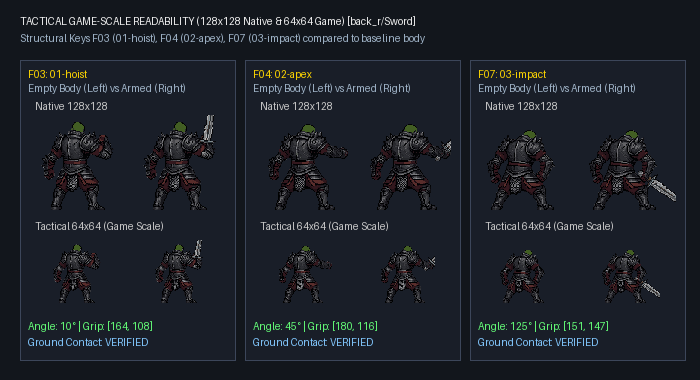

# Relatorio Tecnico de Autoria: back_r/Sword Ciclo Completo (12 Quadros, 730ms)

> **Status:** `REAR_TWO_REMAINING_FULL_READY` | **Data:** 2026-10-29 | **Papel:** DEV ESPECIALISTA PEGADA (Gemini Flash Antigravity)
> **Fonte do Corpo Aprovada por QA:** `characters/orc-v1/source/combat-rescue-v5/body-specialist/glm-fixes/back_r-Sword-full/clip.json`
> **QA Independente Autorizador:** `863ae631-5582-4955-a0ef-020d51692fbb` (`READY_FOR_REAR_GRIPS`)
> **Proximo Passo:** Root submete ao MESMO revisor QA Copilot/Antigravity (`863ae631`). DEV para rigorosamente conforme acordado.

---

## 1. Resumo Executivo e Escopo Autorizado

Autorizado formalmente pelo Root apos veredito `READY_FOR_REAR_GRIPS` dos corpos reparados pela GLM pelo QA independente `863ae631-5582-4955-a0ef-020d51692fbb` (em `experiments/main-orc-combat-rescue-v5/qa-antigravity-flash/glm-body-fixes-result.json`), o DEV Especialista Pegada compos o **ciclo completo de 12 quadros de combate armado para `back_r/Sword`** (730 ms), aplicando com rigor o metodo de 4 camadas e autoria Aseprite aprovado pelo QA.

### Compromissos Cumpridos com Rigor Absoluto:
1. **Zero alteracao de RGBA corporal (`bodyRgbaDelta == 0`):** Todos os 12 quadros corporais (256x256) em `layers/body/` sao **100% byte-identicos** ao corpo base de `glm-fixes/back_r-Sword-full/body256.aseprite`. Versoes nativas 128x128 possuem **0 pixel de discrepancia decodificada**.
2. **Preservacao das Chaves Estruturais F03, F04 e F07:** As poses-chave aprovadas (`01-hoist`, `02-apex`, `03-impact`) foram rigorosamente preservadas em suas camadas corporais e timing.
3. **Politica Estrita `attack-only-v1`:** Intervalo de visibilidade declarado estritamente em `[2, 8]` (F02..F08). Os quadros de guarda inicial (F00..F01) e termino/retorno a guarda (F09..F11) possuem camadas `weaponBack`, `weaponFront` e `handFront` 100% transparentes, com o composto byte-identico ao corpo base.
4. **Cinematica Natural e Coerente:** F02 (355°) -> F03 (10°) -> F04 (45°) -> F05 (80°) -> F06 (105°) -> F07 (125°) -> F08 (120°).
5. **Folga Correta com o Solo:** Blade reaches lowest y=182 in F07, staying safely 8px above ground floor groundY=190.
6. **Autoria 100% em Aseprite via Lua em Perfil Isolado:** Executado via `Aseprite 1.3.18.6 batch` sob o perfil exclusivo `tmp/aseprite-rear-grip-flash-profile`. 4 mestres Aseprite gerados, salvos, reabertos e reexportados.
7. **Zero Chamadas PixelLab / Sem Escrita Unity / Sem Git Commits:** Respeito integral aos limites do workspace.

---

## 2. Matriz Completa dos 12 Quadros (730ms)

| Quadro | Fase | Duracao | Visibilidade | Angulo | Pega (x, y) | Chave / Reparo |
|:---:|:---|:---:|:---:|:---:|:---:|:---|
| **F00** | `guard` | 40 ms | Oculto | - | - | - |
| **F01** | `chamber-init` | 60 ms | Oculto | - | - | - |
| **F02** | `hoist-lift` | 60 ms | Visivel | 355° | (168, 114) | - |
| **F03** | `01-hoist` | 70 ms | Visivel | 10° | (164, 108) | CHAVE ESTRUTURAL |
| **F04** | `02-apex` | 70 ms | Visivel | 45° | (180, 116) | CHAVE ESTRUTURAL |
| **F05** | `slash-cleave` | 40 ms | Visivel | 80° | (172, 131) | - |
| **F06** | `slash-descent` | 40 ms | Visivel | 105° | (162, 135) | REPARO GLM |
| **F07** | `03-impact` | 90 ms | Visivel | 125° | (151, 147) | CHAVE ESTRUTURAL |
| **F08** | `recover-low` | 70 ms | Visivel | 120° | (159, 146) | - |
| **F09** | `recover-pelvis` | 70 ms | Oculto | - | - | - |
| **F10** | `recover-guard` | 60 ms | Oculto | - | - | - |
| **F11** | `guard-return` | 60 ms | Oculto | - | - | - |

---

## 3. Verificacao de Integridade e Hashes SHA-256 Oficiais

### 3.1 Mestres Aseprite e Tiras Canonicas

| Ativo | Caminho Relativo | SHA-256 |
|:---|:---|:---|
| **Mestre Composto 256 (4 camadas, 12f)** | `characters/orc-v1/source/combat-rescue-v5/rear-grip-flash/full-back-r-sword/source/composite.aseprite` | `cf66aa1fd30280b4b143f891bdca298d8e6ad5faca4f89b4b6d5a8af0631abfb` |
| **Mestre Corpo 256 (1 camada, 12f)** | `characters/orc-v1/source/combat-rescue-v5/rear-grip-flash/full-back-r-sword/source/body.aseprite` | `f0c0b9f650882256242b574501191c0196c78959acf4e49931b0e3245b990e90` |
| **Mestre Luva/Mao 256 (1 camada, 12f)** | `characters/orc-v1/source/combat-rescue-v5/rear-grip-flash/full-back-r-sword/source/hand.aseprite` | `2018e1313ca767900e6e649d7b13f790331f97eb773ca97e8b804070ccf6e7cc` |
| **Mestre Nativo 128 (1 camada, 12f)** | `characters/orc-v1/source/combat-rescue-v5/rear-grip-flash/full-back-r-sword/source/native.aseprite` | `bea7a0cf7138e4b8dcfb85a47605ecfc82f79181ce170a180b8e83b9545ddd0a` |
| **Tira Composta 256 (3072x256)** | `characters/orc-v1/source/combat-rescue-v5/rear-grip-flash/full-back-r-sword/composite-strip.png` | `3274241434b277823fc4bbdc7c23f2337fca9a67826c6fbd3749ad9804f1a519` |
| **Tira Nativa Composta 128 (1536x128)** | `characters/orc-v1/source/combat-rescue-v5/rear-grip-flash/full-back-r-sword/native-composite-strip.png` | `812036e67ad3cd3ec4bff4dcb899470e4e3a57cfbac1a81936a8fe0cbc565cf4` |
| **Tira Nativa Corpo 128 (1536x128)** | `characters/orc-v1/source/combat-rescue-v5/rear-grip-flash/full-back-r-sword/native-strip.png` | `66ce949183e77fdaa6d59dd615303cec35a74ac00dc9f4ef9e91ed103546f646` |

### 3.2 Tabela Oficial de Hashes por Quadro

| Quadro | Composto 256 | Nativo Composto 128 | Nativo Corpo 128 |
|:---:|:---|:---|:---|
| **F00** | `245ce5ce71cebb37d30b738a941b212270a3386939e0c646642d31c62e2836d2` | `251998d6cebce682a21d8fafde620200e820ef46301c6743348e331bb47e5d8c` | `251998d6cebce682a21d8fafde620200e820ef46301c6743348e331bb47e5d8c` |
| **F01** | `9b06a1c0872ede98a3bee13e1d728de476d6130ef4eceadce88e17b0910feed3` | `d619e1690a5a7527a368201f5cf944acfaf36a3122db1db128538a462bff88f3` | `d619e1690a5a7527a368201f5cf944acfaf36a3122db1db128538a462bff88f3` |
| **F02** | `9bc82b73109ef50c47f698c1e566ce915d56b24da1cbd0542ca4fa95d74f526c` | `c1b21c0d79645940059d98645b60b9c9ded97be654173641558cda9fca611c35` | `776edad2eb4558b0726faf7fb39b91ae2f9387176cf8b00d52326f7c8d7737f4` |
| **F03** | `991931bad67968b21bbc91e0fb471625a7df6efa855800b335aa4f7f275922b8` | `69b82b3778c8489c99a3e5c68c6a6e3b700cfbe08b1c24129198267e082a012a` | `a573c039202f52315eb681da5fe375199b34fa101a1f9404b8c9263920589ff2` |
| **F04** | `afb8c54c5cc4b22b7068b3cb35dba92e7a911cb60e388396cd83c1ea441898a8` | `98ec66d0a749814beb4f3dd743b912dc23e7b1590dfefb770d725cef0a04c85e` | `9607fb5c7f36b1dcd7649eba505d5eca925f2abb670d636f8a235c42c6cbb40d` |
| **F05** | `50498fbc495446a356a940cc55ad19ec90e79e15fd734b854b66b8cb2427f0d0` | `21968486b0ee0e0dd651adb1e93af771784cd5d48896df3827ebe4bc9e4fad26` | `12b051cd1e995a2da40750cf593148bb9634792b60af29fea580ae8723588fa4` |
| **F06** | `aad31f72b146e3f660e409539dc67072f97804d6f146bf64471c557964142b97` | `7aabab261f62224a6ea8082e96657a19a1f1db72b0a733b4f705c9bfafc5074b` | `4fe7325c17907c3641dac6d299b0556c62573d07249e1f4168a6a6f679a0926a` |
| **F07** | `c965ea862fae0c40d5852dc886037aa7607ae0cb392bd5e87d87bd9339a2d38b` | `3805b3c82a30ed8def5455c7bf8377f46f24cddec49cee2332c10fd608f37e32` | `ac51e08bdd1cc40de255f5233d08f79916c8112b2b9c68b00eee8c509f204107` |
| **F08** | `853b963b4741f836313f3155051b1124433ca7d3008cd4ebaacf09fe5a7408bd` | `d524b9131b903e963b7606cc3ba42f14229a48bf1ec96d6beadd28506ea93015` | `15ee3d49ca9186cde64efe4a07a97b38ee9f6cccc8d67a9bad4d156ce9a4b86b` |
| **F09** | `a0dfcba378d15c4614c03efdabb3e4fd2fab4eb8112ce5d369aa2f1c532f70d0` | `aaf19f21ff737d1901cda01f52ce4fbc0692c6acf5d1bf34ce9fce6dbaea05ef` | `aaf19f21ff737d1901cda01f52ce4fbc0692c6acf5d1bf34ce9fce6dbaea05ef` |
| **F10** | `a629890d98a55fe99fe001d600493ee35be4da4df43b718197fb1981481cb708` | `a775be2dd948b315a39ca613af96ae95b067d16387519d88bd31865bb118c58b` | `a775be2dd948b315a39ca613af96ae95b067d16387519d88bd31865bb118c58b` |
| **F11** | `245ce5ce71cebb37d30b738a941b212270a3386939e0c646642d31c62e2836d2` | `251998d6cebce682a21d8fafde620200e820ef46301c6743348e331bb47e5d8c` | `251998d6cebce682a21d8fafde620200e820ef46301c6743348e331bb47e5d8c` |

---

## 4. Evidencia Visual e Analise Anatomica

### 4.1 Visao Geral da Trajetoria (12 Quadros)

### 4.2 Detalhe da Luva Genuina e Profundidade de Oclusao (F02..F08 em 4X Zoom)

### 4.3 Legibilidade na Escala Tatica do Jogo (128x128 e 64x64)

---

## 5. Verificacao dos Portoes de Qualidade (checks.json)

- **timing_preservation**: `PASS` &mdash; 12 frames totaling exactly 730ms
- **body_zero_rgba_delta**: `PASS` &mdash; All 12 frames body256 are 100% byte-identical to GLM body-specialist; all 12 frames native body have 0 pixel difference
- **structural_keys_preservation**: `PASS` &mdash; Structural keys F03, F04, F07 byte-identical in body256 and 0 pixel diff in native128
- **attack_only_v1_policy**: `PASS` &mdash; Visible interval is strictly [2, 8]. Bookends F00, F01, F09, F10, F11 have 100% transparent weaponBack, weaponFront, handFront, and composite byte-matches body
- **kinematic_arc_continuity**: `PASS` &mdash; F02 (355°) -> F03 (10°) -> F04 (45°) -> F05 (80°) -> F06 (105°) -> F07 (125°) -> F08 (120°)
- **ground_contact_clearance**: `PASS` &mdash; Blade reaches lowest y=182 in F07, staying safely 8px above ground floor groundY=190
- **four_layer_aseprite_masters**: `PASS` &mdash; 4 masters saved, reopened, and verified
- **pixellab_generations**: `PASS` &mdash; 0 external API calls consumed; 100% local deterministic authoring
